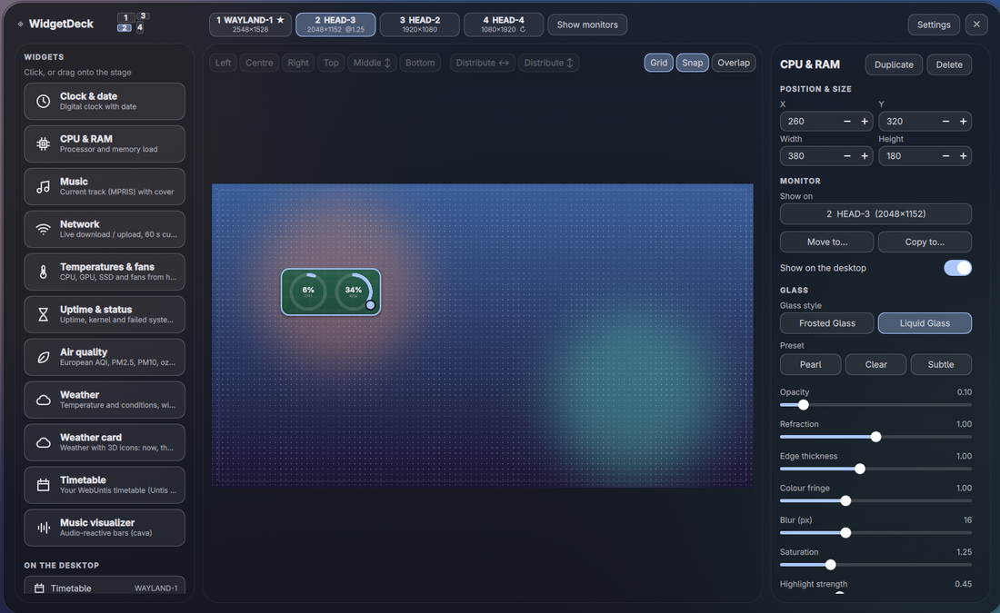
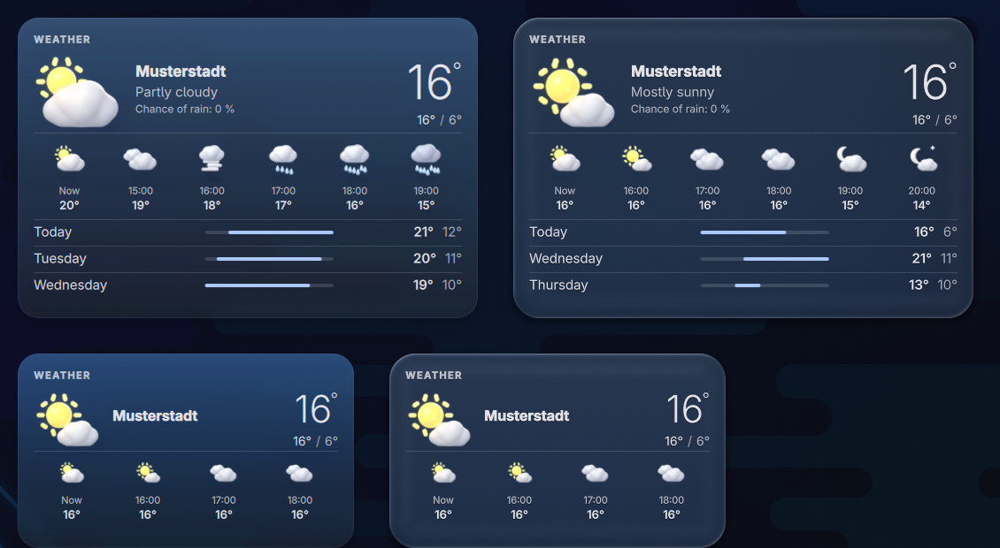
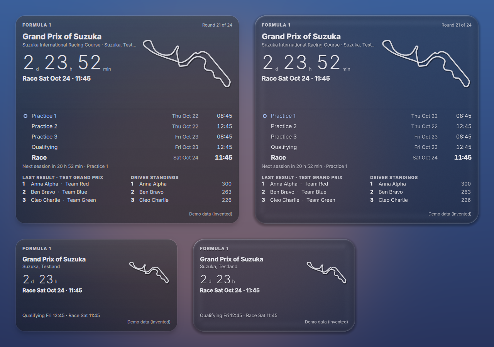

# WidgetDeck

Desktop-Widgets für **Hyprland** unter **Arch Linux** mit Quickshell: Uhr, CPU/RAM, Musik, Visualizer, Netzwerk, Temperaturen, Systemstatus, Luftqualität, Wetter (mit Regen- und Schneepartikeln) eine Formel-1-Wochenendkarte und ein Fokus-Timer im Look **Frosted Glass** oder **Liquid Glass**. Ein eingebauter **Builder** ordnet alles per Maus an: Raster, Hilfslinien, Mehrfachauswahl, Ausrichten und Verteilen.

Es läuft eigenständig: keine Dotfiles des Autors, keine andere Quickshell-Konfiguration, kein Icon-Theme und keine bestimmte Schrift nötig. Optionale Teile (Leiste, Benachrichtigungsdienst mit Power-Menü) sind **standardmäßig aus**.

> English version: [README.md](README.md)

**Unterstützt wird nur Arch Linux** (Hyprland + Quickshell aus den offiziellen Repos).

| Liquid Glass | Frosted Glass |
|---|---|
|  |  |


_Screenshots aus einer sauberen Testsitzung: neutrales Wallpaper, Demo-Standort und -Netzwerkname, keine persönlichen Daten._

## Installation

```bash
git clone https://github.com/Julix2009/WidgetDeck-.git && cd WidgetDeck- && ./install.sh
```

Der Installer fragt, bevor er etwas ändert, das dir gehört. Danach `hyprctl reload` (oder neu anmelden): WidgetDeck startet mit der Sitzung, und einmalig öffnet sich ein kurzer **Einrichtungsassistent** (Wallpaper, Standort, Einheiten, Stil, Größe, Widgets). Nichts braucht einen Neustart oder Handarbeit.

Optionen: `--dry-run`, `--yes`, `--modules widgets,builder,bar,notifications`, `--no-hypr-config`, `--prefix <Ordner>`, `--channel stable`, `--uninstall`.

## Pakete

Alle aus den **offiziellen Repos** (kein AUR): Pflicht `quickshell qt6-declarative qt6-wayland qt6-shadertools jq curl iproute2 iputils`; empfohlen `adwaita-fonts`; optional `python` (Formel-1- und Stundenplan-Widget: ihre Datenhelfer nutzen nur die Standardbibliothek) `networkmanager playerctl cava matugen` (ohne Matugen gilt eine feste Standard-Palette). Icons zeichnet WidgetDeck selbst: kein Icon-Font, kein Icon-Theme.

## Kompatibilität

Getestet: Hyprland **0.55.4** (`hyprland.conf` und Lua), Quickshell 0.3.0 mit Qt 6.11.1, Intel-GPU, awww als Wallpaper-Werkzeug (swww, hyprpaper, swaybg, wpaperd nur mit simulierter Ausgabe), ein echter Monitor plus virtuelle Monitore mit Skalierung 1.5. **Ungetestet:** Hyprland 0.53/0.54 und ältere Versionen (alte Regel-Syntax), AMD- und NVIDIA-GPUs, uwsm. Mehr in der englischen README (Tabelle „Compatibility“).

## Was es ändert – und was nicht

Es legt Programmdateien nach `~/.config/quickshell/widgetdeck/`, drei Befehle nach `~/.local/bin/`, **deine** Einstellungen nach `~/.config/widgetdeck/` (werden nie überschrieben) und Cache/Log nach `~/.cache/widgetdeck/`. Die Hyprland-Regeln stehen in einer **eigenen Datei** `~/.config/hypr/widgetdeck.conf` (bzw. `.lua`); in deine Config kommt nur nach Rückfrage **eine markierte Verweiszeile**, mit Zeitstempel-Backup und vorheriger Prüfung per `Hyprland --verify-config`. Es beendet, deaktiviert oder ersetzt **kein** anderes Programm, ändert sonst nichts an deiner Hyprland-Config, nutzt kein AUR und läuft nicht als root.

**Netzwerk** (alles optional): Wetter von open-meteo.com (nur Koordinaten). Der Standort kann einmalig per IP über ipwho.is bestimmt werden (eine Woche gespeichert) – der Assistent erklärt es, du kannst auch Koordinaten eintragen oder das Wetter abschalten. Das **Formel-1-Widget** (nur wenn du es hinzufügst) lädt Kalender, Ergebnisse und Wertung von Jolpica-F1 (api.jolpi.ca, ohne Schlüssel, wenige Anfragen pro Tag für alle Widgets und Monitore zusammen) und – nur wenn du *Live-Daten* einschaltest – eine laufende Session von OpenF1 (api.openf1.org); es werden keine persönlichen Daten gesendet. Der tägliche Update-Check macht `git ls-remote` auf dieses Repo und lässt sich abschalten.

## Module

Widgets (an), Builder und Raster (an), Leiste (**aus**), Benachrichtigungen und Power-Menü (**aus**). Auswahl beim Installieren (`--modules`) oder später im Builder unter *Einstellungen → Module*, oder `widgetdeck module bar on|off`. Vor Leiste und Benachrichtigungsdienst sucht WidgetDeck nach waybar, ags, eww, hyprpanel, dunst, mako, swaync u. Ä., sagt dir, was du zuerst abschalten musst, und **beendet nie selbst etwas**. Die Widgets laufen auch ohne Leiste; alles ist per IPC erreichbar (`widgetdeck ipc powerPanel` usw.), die Regeldatei enthält auskommentierte Beispiel-Binds.

## Erster Start und Alltag

`widgetdeck builder` öffnet den Editor (Alt = freies Ziehen, Shift = Mehrfachauswahl). Den Assistenten startest du erneut mit `widgetdeck wizard`. **Liquid Glass** bricht dein Wallpaper und braucht deshalb die Bilddatei (automatisch bei awww, swww, hyprpaper, swaybg, wpaperd; sonst Bild wählen); ohne Wallpaper oder Shader nutzen alle Widgets Frosted Glass.

**Setup prüfen:** `widgetdeck-doctor` gibt OK / WARN / FAIL mit Lösungsvorschlag aus. Die Ausgabe verbirgt dein Home-Verzeichnis und enthält weder Standort noch Wallpaper-Pfad – du kannst sie in ein GitHub-Issue kopieren.

## Mehrere Monitore



WidgetDeck erkennt deine Monitore selbst (Quickshell + `hyprctl monitors`): Name, Hersteller / Modell, Position, Auflösung, Skalierung, Drehung, Bildwiederholrate, reservierte Flächen (eine Leiste) und eine **stabile Kennung** (Hersteller + Modell + Seriennummer, sonst die Beschreibung - der Anschluss allein ist nie die Identität, DP-1 kann nach einem Neustart ein anderer Monitor sein; zwei gleiche Monitore ohne Seriennummer unterscheidet der Anschluss). Gespiegelte Monitore zählen einmal, deaktivierte werden ignoriert. Ein- und Abstecken wird live erkannt, ohne Neustart.

* **Ein Monitor:** nichts ändert sich, nichts Zusätzliches erscheint.
* **Mehrere Monitore:** der Builder zeigt eine Auswahl (Karten plus kleine Anordnungs-Übersicht) und den Knopf *Monitore anzeigen* (große Nummer und Name auf jedem Bildschirm für einige Sekunden). Raster, Einrasten und Hilfslinien gelten für den gewählten Monitor; seine Widgets stehen auf der Bühne mit dem eigenen Hintergrundbild dieses Monitors.
* **Widgets und Monitore:** jedes Widget hat *Anzeigen auf*: ein bestimmter Monitor, *Hauptmonitor* (Standard) oder *Alle Monitore* (je eine Instanz, gleicher Versatz), dazu *Verschieben nach …* und *Kopieren nach …*. Derselbe Widget-Typ darf mehrfach vorkommen, jeder mit eigener Position und Größe. Positionen werden in Rasterzellen relativ zur nutzbaren Fläche des Monitors des Widgets gespeichert (eine Leiste verkleinert nur ihren eigenen Monitor). *Layout dieses Monitors kopieren nach …* rechnet ein ganzes Layout auf eine andere Auflösung um. Zellengröße, Randabstand, Größe neuer Widgets und ein manuelles Hintergrundbild lassen sich pro Monitor einstellen (Einstellungen); Glasstil und Glas-Parameter bleiben global.
* **Abziehen:** Widgets eines fehlenden Monitors werden nicht gelöscht, sie warten (Standard) oder wandern auf den Hauptmonitor (Einstellung) und kehren an ihren Platz zurück. Ein neuer, unbekannter Monitor startet leer, und der Builder bietet an, das Layout eines anderen zu übernehmen. Optional: ein Widget über den Monitorrand ziehen verschiebt es auf den Nachbarn (Einstellung).
* **Glas:** die Widgets jedes Monitors brechen das Hintergrundbild genau dieses Monitors (pro Ausgabe bei awww, swww, hyprpaper, swaybg, wpaperd; ein manueller Pfad pro Monitor geht immer).
* **Daten werden nur einmal abgefragt**, nicht pro Monitor: Wetter, Luftqualität, Stundenplan, Netzwerk (ein Ping), CPU / RAM, Temperaturen, Visualizer und die Player-Beobachtung laufen als gemeinsame Feeds, die alle Widget-Instanzen nur lesen.
* **Leiste, Benachrichtigungen, Power-Menü:** die Leiste lässt sich pro Monitor schalten und zeigt die Workspaces ihres eigenen Monitors; Benachrichtigungen und Power-Menü erscheinen auf dem fokussierten, dem Haupt- oder einem gewählten Monitor (Einstellungen). Die Layerrules gelten pro Namespace und damit für jeden Monitor.
* **Einstellungen:** `~/.config/widgetdeck/config.json`, Schlüssel `monitors` (`primary`, `unplugged`, `cross_edge`, `notify`, `bar`). Die Layout-Datei ist v3 (eine ältere wird beim ersten Start als `widgets.json.v2-backup-<Datum>` gesichert und ohne Verschieben umgewandelt).
* `widgetdeck-doctor` listet jeden Monitor (kurze Kennung statt Seriennummer, Auflösung, Skalierung, Drehung, Hintergrund-Werkzeug, Anzahl Widgets).

## Wetter-Karte (3D-Icons)


_Erfundener Ortsname, neutrale Demo-Sitzung._

Ein zweites Wetter-Widget neben dem schlichten *Wetter*: ein großes 3D-Icon für das aktuelle Wetter, Ort, Beschreibung und Regenwahrscheinlichkeit, die Temperatur in leichter Schrift mit Höchst-/Tiefstwert, eine Leiste mit den nächsten 4-8 Stunden (kleines Icon über der Uhrzeit, 12 h oder 24 h nach deinen Einstellungen) und eine Liste der nächsten 3-7 Tage mit optionalen dünnen Temperaturbalken. Die Größe *Klein* zeigt Icon, Ort, Temperatur, Höchst-/Tiefstwert und vier Stunden; *Klein / Groß* im Builder animiert dazwischen. Die Karte nutzt **dieselben Daten wie das Wetter-Widget** - dasselbe Skript, denselben Standort und dieselben Einheiten, eine Open-Meteo-Abfrage alle 10 Minuten für alle Wetter-Widgets zusammen (eine Sperre lässt gleichzeitige Widgets auf die erste warten) - und zeigt offline „Stand HH:MM“ mit den letzten Werten. Fehlende Felder werden ausgeblendet.

Die Icons sind weiche, knetartige 3D-Objekte (Wolken aus überlappenden weichen Kugeln, leuchtende Sonne, glänzende Tropfen, Mondsichel mit Kratern, Flocken, Blitz, Hagel, Nebel), von links oben beleuchtet, für 12 Wettertypen bei Tag und Nacht. Es sind **echte 3D-Renderings** aus Blender (Cycles), erzeugt von `tools/blender/render.sh` aus einer prozeduralen Szenenbeschreibung (`tools/blender/icon_scenes.py`, weiche Metaball-Modelle, keine Netze oder Texturen von anderswo); die fertigen Bilder liegen im Repository (`qml/widgets/weathercard/icons3d/`), **Blender braucht man also nur zum Neuerzeugen**. Jedes Icon ist in getrennten Ebenen (Sonne, Wolke, Tropfen, Schatten, ...) aus 5 x 3 Blickwinkeln gerendert; die Karte blendet beim Darüberfahren die benachbarten Winkel ineinander, das Objekt dreht sich also wirklich zur Maus. Zur Laufzeit zeigt die Karte nur Bilder und kostet nichts, solange sich nichts bewegt. Optionen: *Animationen* Aus / Dezent (Standard) / Voll - das große Icon schwebt leicht, Wolken driften, die Sonne atmet, Tropfen fallen in kleinen Schlaufen, beim Darüberfahren dreht sich das Icon und ein Lichtreflex folgt der Maus; bei *Aus* läuft gar nichts. *Himmel-Verlauf* (nur Milchglas, nie bei Liquid Glass) färbt die Karte dezent nach Wetter und Tageszeit. *Test: Wetter erzwingen* / *Test: Tag / Nacht* zeigen jedes Icon, ohne aufs Wetter zu warten. Das Glas hinter der Karte ist allein die gemeinsame Glas-Komponente; Liquid Glass / Milchglas richtet sich nach dem globalen Umschalter.

## Formel-1-Widget (inoffiziell)



> **Inoffizielles Fan-Widget.** Keine Verbindung zu Formula 1, FIA, Teams oder Fahrern; „Formula 1“, „F1“, „FIA“ und verwandte Marken gehören ihren Inhabern. Es werden keine Logos, Team- oder Fahrerbilder mitgeliefert oder geladen und nichts von Webseiten gelesen. Der Screenshot zeigt **erfundene Demo-Daten** (die *Test*-Optionen des Widgets).

Es zeigt das nächste Rennwochenende: den **Umriss der Strecke**, einen **Countdown** und **alle Sessions des Wochenendes in deiner Ortszeit** (drei Trainings, Qualifying, Rennen – bei Sprint-Wochenenden Training 1, Sprint-Qualifying, Sprint, Qualifying, Rennen), dazu das **letzte Ergebnis** (Podium) und die **Fahrerwertung** (Platz 3 bis 10). *Klein / Groß* im Builder wechselt zwischen der kompakten Karte (Strecke, Name, Countdown, Rennzeit, Qualifying und Rennen) und der großen (alle Sessions, Ergebnis, Wertung; wie viele Wertungsplätze erscheinen, hängt vom Platz in der Karte ab). Zeiten und Daten folgen der Systemzeitzone samt Sommerzeit, 12 h / 24 h kommt aus den Einstellungen (oder dem eigenen *Zeitformat* des Widgets), die Sprache aus der Spracheinstellung. Die Landesflagge neben dem Ort ist ein Emoji und erscheint nur, wenn eine Emoji-Schrift installiert ist (z. B. `noto-fonts-emoji`); der Ländername steht immer da.

* **Zustände:** *bevorstehend* (Countdown zum Rennen, die nächste Session ist markiert); *Session läuft* (optional Live-Ansicht); *Rennen beendet* (Ergebnis und nächstes Rennen; bis das Ergebnis da ist, wird alle 10 Minuten nachgefragt); *Saison beendet* (Meister, später der Kalender der nächsten Saison); *abgesagt / verschoben* (markiert, mit dem alten Datum); *offline* (letzte Daten mit „Stand: HH:MM“); *noch keine Daten* (Schaltfläche *Neu laden*). Wechsel blenden weich über, das Layout springt nie.
* **Countdown:** ein Takt pro Minute, in der letzten Stunde einer pro Sekunde; nur der Zahlentext ändert sich, das Glas wird nicht neu gezeichnet.
* **Daten und Anfragen:** [Jolpica-F1](https://github.com/jolpica/jolpica-f1) (Nachfolger von Ergast, ohne Schlüssel) für Kalender (höchstens einmal pro Tag), Ergebnisse und Wertung (alle 6 Stunden) und [OpenF1](https://openf1.org) für abgesagte Sessions. Alles wird **einmal** von einem gemeinsamen Feed geholt (nicht pro Widget, nicht pro Monitor) – mit `qml/widgets/f1/f1.py` (nur Python-Standardbibliothek, nur HTTPS mit Zertifikatsprüfung), in `~/.cache/widgetdeck/f1.json` zwischengespeichert und offline weiterverwendet. Nach einem Fehler wird die Quelle 5 Minuten in Ruhe gelassen, verdoppelt bis 2 Stunden; HTTP 429 und `Retry-After` werden befolgt. Ein normaler Tag sind etwa 10 Anfragen; Jolpica erlaubt 500 pro Stunde. `widgetdeck-doctor` prüft beide Quellen und das Alter des Zwischenspeichers.
* **Live-Ansicht (standardmäßig aus):** *Live-Daten während einer Session* zeigt Flaggenstatus und die ersten Drei von OpenF1, solange eine Session läuft und das Widget sichtbar ist. Verlangt OpenF1 für Echtzeitdaten eine Anmeldung, bleibt die Karte in der normalen Ansicht. Dieser Teil konnte bei der Entwicklung nicht gegen eine echte Live-Session geprüft werden.
* **Erinnerung (standardmäßig aus):** *Vor Sessions erinnern* sendet 15 Minuten vor den gewählten Sessions (Training / Qualifying / Rennen und Sprint) eine `notify-send`-Meldung.
* **Streckenumrisse:** 40 Strecken (der ganze aktuelle Kalender und frühere) aus dem MIT-lizenzierten GeoJSON von [bacinger/f1-circuits](https://github.com/bacinger/f1-circuits), von `tools/f1/build_circuits.py` zu einer sauberen geschlossenen Linie vereinfacht (ohne Namen, ohne Logos). Die fertige Datei liegt bei WidgetDeck, dafür wird nichts nachgeladen. Fehlt eine Strecke, bleibt der Umriss einfach weg und das Shell-Log nennt sie. *Umriss einmal einzeichnen* lässt die Linie beim ersten Anzeigen eines Wochenendes wachsen.
* **Testoptionen** in den Einstellungen des Widgets: *Test: Wochenende* (normal / Sprint / Session läuft / Rennen gerade beendet / Saison beendet / abgesagt / noch kein Ergebnis) und *Test: Strecke* nutzen erfundene Daten und brauchen kein Netz.
* **Glas:** Die Karte nutzt nur das gemeinsame Glas-Panel; Frosted / Liquid Glass, Raster, Einrasten, Größen und Monitore funktionieren wie bei jedem anderen Widget. Die Layer-Regeln der Hyprland-Datei gelten pro Namespace, es ist **keine neue Regel nötig**.
* **Lizenzen der Daten:** Jolpica-F1-Daten stehen unter CC BY-NC-SA 4.0 (nur nicht-kommerzielle Nutzung, [Bedingungen](https://github.com/jolpica/jolpica-f1/blob/main/TERMS.md)); OpenF1 ist ein inoffizielles Projekt. Einzelheiten in `NOTICE.md`.

## Fokus-Timer (Pomodoro)

Ein Ring mit der Restzeit, der Phase und den heutigen Sessions. **Ein Timer** für alle Instanzen und Monitore: er lebt mit der Shell (`widgets/focustimer/FocusTimerService.qml`), nicht mit einem Widget-Fenster – Ausblenden, Verschieben, Größenwechsel oder ein abgezogener Monitor stoppen oder löschen ihn nie.

* **Phasen:** Fokus (25 min), kurze Pause (5 min), lange Pause (15 min nach 4 Fokus-Sessions). Alle Längen, die Anzahl der Sessions und *Nächste Phase automatisch starten* (standardmäßig aus) sind Widget-Einstellungen (*Fokus-Timer* im Builder) und für alle Instanzen gleich (eine ändern ändert alle). Die Phasen unterscheiden sich durch Text, Icon und Theme-Farbe (primary / tertiary / secondary der Matugen-Palette), nie durch eine Füllung auf dem Glas.
* **Größen:** *Groß* (300 x 380): Ring mit Restzeit in der Mitte, Phase, Session-Punkte (einer je Fokus-Session bis zur langen Pause), Fokuszeit heute, **Start / Pause**, **Überspringen**, **Zurücksetzen**. *Klein* (200 x 200): Ring, Zeit und Phase; die Tasten erscheinen beim Hover, ein Klick auf den Ring startet / pausiert. Die Größen stehen in der zentralen Größen-Tabelle in logischen Pixeln, das Widget wirkt also auf 1080p und 4K (und bei Skalierung 1.25 / 1.5 / 2.0) gleich groß.
* **Steuerung von außen** (Tastenkürzel): `focus-timer toggle | start | pause | reset | skip | status [--json]` (wird nach `~/.local/bin` installiert, `uninstall.sh` entfernt es). `status` gibt z. B. `Fokus 24:59 (läuft) · Session 1/4 · heute 3 Sessions, 75 min` aus. Der Befehl spricht über Quickshell-IPC (Target `focustimer`) mit dem laufenden WidgetDeck.
  Hyprland (`hyprland.conf`; bei neuen Installationen stehen die Zeilen auch im auskommentierten Kürzel-Block der Regeldatei `~/.config/hypr/widgetdeck.conf`):
  ```
  bind = SUPER, F, exec, focus-timer toggle
  bind = SUPER SHIFT, F, exec, focus-timer skip
  ```
  Lua-Config (Hyprland >= 0.55): `hl.bind("SUPER + F", hl.dsp.exec_cmd("focus-timer toggle"))`.
* **Fokus-Modus** (Einstellung *Benachrichtigungen im Fokus pausieren*, standardmäßig aus): Während einer **laufenden** Fokus-Phase ist „Nicht stören“ an; der vorherige Zustand kommt zurück, wenn die Phase endet, pausiert, übersprungen oder zurückgesetzt wird, die Shell endet oder (nach einem Absturz) beim nächsten Start. Ein selbst gesetztes „Nicht stören“ wird nie aufgehoben, ein im Fokus selbst aufgehobenes nicht wieder eingeschaltet. Funktioniert mit dem Benachrichtigungsmodul von WidgetDeck, **dunst** (`dunstctl set-paused`), **mako** (`makoctl mode`, Modus `do-not-disturb`), **swaync** (`swaync-client -dn / -df`) und Benachrichtigungs-Shells, die einer Flag-Datei folgen (`~/.cache/quickshell/dnd/state`, 1 = still). Die Meldung am Phasenende kommt, nachdem die Stille aufgehoben wurde – sie wird also gesehen.
* **Phasenende:** ein kurzer Ton (eigene Arbeit: `tools/focustimer/make_chime.py` erzeugt `qml/widgets/focustimer/chime.wav` aus Sinuswellen, keine fremden Audiodaten) über `pw-play`, `paplay`, `ffplay`, `canberra-gtk-play` oder `aplay` (der erste vorhandene; Lautstärke einstellbar) und eine Benachrichtigung (`notify-send`); beides einzeln abschaltbar. Eine Phase, die endete, während die Shell nicht lief oder der Rechner schlief, wird **einmal** und leise gezählt, der Timer wartet pausiert in der nächsten Phase.
* **Statistik:** `~/.config/widgetdeck/focus-stats.json` (Schema `v: 1`): je lokalem Tag die abgeschlossenen Fokus-Sessions und Fokus-Sekunden; nur vollständig beendete Fokus-Phasen zählen (übersprungene und zurückgesetzte nicht); atomar und nur bei Änderungen geschrieben; die letzten 365 Tage bleiben. Eine beschädigte Datei wird nach `focus-stats.json.damaged-<Datum>` kopiert und eine neue begonnen. Der laufende Zustand steht in `focus-state.json` daneben: ein Neustart der Shell oder des Rechners macht dort weiter.
* **Kosten:** nichts, solange pausiert; während eine Phase läuft ein Timer, der bis zum Ende schläft (höchstens 20 s am Stück, damit Standby bemerkt wird), und nur bei sichtbarem Widget ein Neuzeichnen des Rings pro Sekunde.
* **Testschalter:** *Test: Phasen von Sekunden* (Fokus 10 s, kurze Pause 4 s, lange Pause 6 s) lässt einen ganzen Satz in einer Minute durchlaufen. `widgetdeck-doctor` prüft den Befehl, die IPC, den Benachrichtigungsdienst, den Audio-Player und die beiden Dateien.

## Musik-Widget: zwei Stile


_Demo-Daten (erfunden), neutraler Hintergrund._

Das Musik-Widget zeigt den aktuellen Titel eines beliebigen MPRIS-Players. Die Option **Stil** (Widget-Einstellungen im Builder) schaltet live und mit Überblendung zwischen **Normal** (Cover, Fortschrittsbalken, Tasten) und **Schallplattenspieler** um: eine drehende Platte mit Rillen und dem Cover als Label, ein Tonarm, der beim Start auf die Platte schwenkt, dem Fortschritt folgt und bei Pause oder Songwechsel abhebt, daneben Titel, Interpret, Zeit und Tasten (klein: darunter, Tasten beim Darüberfahren). Ein Klick auf Platte oder Tonarm schaltet Play/Pause. Optionen: Drehzahl (33 / 45 U/min), Tonarm folgt dem Fortschritt, Vinyl-Farbe (Schwarz / aus dem Cover), Lichtreflex. Beide Stile lesen denselben Zustand, das Glas dahinter ist in beiden die gemeinsame Glas-Komponente. Bei Pause, ohne Player oder wenn das Widget nicht sichtbar ist, läuft nichts. Die Größen stellst du mit *Klein / Groß* im Builder passend zum gewählten Stil ein.

## Stundenplan-Widget (WebUntis / Untis Mobile)


_Demo-Daten (erfunden), neutrales Wallpaper._

Zeigt deinen eigenen WebUntis-Stundenplan: aktuelle und nächste Stunde (kleines Layout) oder Tageszeitleiste und Wochenraster (großes Layout; Widget größer ziehen oder die Knöpfe *Small / Large* im Builder). Entfall ist rot durchgestrichen, Vertretung grün, Prüfung gelb; parallele Gruppen werden zusammengefasst (`+2 parallel`, eigene Gruppe in den Widget-Eigenschaften wählen); Pausen, Freistunden, Wochenende und Ferien erkennt es am Zeitraster der Schule.

Es nutzt den **Untis-Mobile-Zugang** deines eigenen Kontos - oft der einzige Zugang, weil der normale Login hinter einem Microsoft-Login liegt. Einmal einrichten:

1. In WebUntis *Profil → Freigaben → Untis Mobile → Anzeigen* öffnen (der QR-Code). Screenshot oder Foto **lokal** speichern.
2. `widgetdeck-untis-setup` ausführen und den Pfad der Bilddatei angeben (oder die Werte von Hand eintippen). Es liest den QR-Code mit `zbarimg` (Paket `zbar`), prüft den Zugang mit einem Login und legt den Schlüssel im **Schlüsselbund** ab (Secret Service, über `secret-tool` aus `libsecret`).
3. Das Bild vom Setup löschen lassen und andere Kopien entfernen (Downloads, Papierkorb, Cloud-Sync). Wer das Bild hat, kann deinen Stundenplan lesen.
4. Das Widget *Stundenplan* im Builder hinzufügen (oder im Einrichtungsassistenten ankreuzen).

Pakete (offizielle Repos): `python`, `zbar`, `libsecret`, dazu ein laufender Secret Service (gnome-keyring, KeePassXC mit aktiviertem Secret Service, KWallet). Ohne Secret Service bietet das Setup eine private Datei (`chmod 600`) außerhalb des Repos an - nur mit deiner Zustimmung.

**Was gelesen wird:** nur dein eigener Stundenplan (Stunden, Entfall, Vertretung, Raum, Lehrkräfte- und Klassen-Kürzel, Gruppe, kurze Notiz, Prüfungsmarkierung) und das Zeitraster der Schule, über die Untis-Mobile-Schnittstelle (`getUserData2017`, `getTimetable`). **Nie gelesen:** Noten, Abwesenheiten, Hausaufgaben, Nachrichten, Schülernummern, Namen oder E-Mail-Adressen (solche Texte werden entfernt, bevor etwas gespeichert wird). Abruf alle 15 Minuten, solange das Widget sichtbar ist; Cache mit Zeitstempel (`~/.cache/widgetdeck/timetable.json`, Modus 600); offline steht „As of HH:MM“. Der Schlüssel steht nie im Code, in Configs, Logs oder der Kommandozeile: Der Server bekommt nur einen aus ihm berechneten Einmalcode, per HTTPS mit Zertifikatsprüfung. Wird der Schlüssel widerrufen („Geräte abmelden“ in WebUntis), zeigt das Widget „Zugang abgelaufen, bitte neu einrichten“ und behält den letzten Stand. `widgetdeck-untis-setup --remove` löscht Schlüssel und Cache.

Die Schnittstelle ist die der Untis-Mobile-App, nicht offiziell dokumentiert, und eine Schule kann sie abschalten. Erlaubt deine Schule das nicht, sagt das Setup es („Der Server hat den Zugang verweigert“) und speichert nichts. `widgetdeck-doctor` prüft Secret Service, ob ein Schlüssel existiert (ja/nein), ob der Server antwortet und ob der letzte Abruf geklappt hat. Für Screenshots und Tests gibt es die Datenquelle *Demo (erfundene Stunden)*.

## Updates

```bash
widgetdeck-update
```

Der Befehl wird bei der Installation nach `~/.local/bin` gelegt. Er holt den Remote-Stand, zeigt die **Änderungen seit deiner Version** (aus dem Änderungsprotokoll) und fragt, ob aktualisiert werden soll. Danach werden Programmdateien ersetzt, der Shader neu vorkompiliert, fehlende Pakete nach Rückfrage über `pacman` nachinstalliert und die Widgets neu gestartet.

| Befehl | Wirkung |
|---|---|
| `widgetdeck-update --yes` | ohne Rückfrage |
| `widgetdeck-update --dry-run` | zeigt nur, was passieren würde |
| `widgetdeck-update --channel stable` | ab jetzt nur getaggte Releases (`--channel main` = immer der neueste Stand, Standard) |
| `widgetdeck-update --version v0.2.0` | eine bestimmte Version installieren |
| `widgetdeck-update --rollback` | zurück auf die Version vor dem letzten Update, inklusive Backup der Einstellungen |

**Deine Einstellungen bleiben erhalten.** Ein Update berührt nur Programmdateien. Alles in `~/.config/widgetdeck/` (Layout, Positionen, Glas-Regler, Standort) bleibt, wie es ist. Ändert sich das Format, laufen nummerierte Migrationen (`migrations/`) automatisch in der richtigen Reihenfolge – vorher entsteht ein Backup `~/.config/widgetdeck.bak-<Datum>`, und fehlende neue Einstellungen werden mit Standardwerten ergänzt, ohne vorhandene zu überschreiben. Schlägt etwas fehl, wird die vorherige Version samt Einstellungen automatisch wiederhergestellt.

**Eigene Änderungen an Dateien** im geklonten Ordner erkennt das Skript: Es bietet an, sie per `git stash` zu sichern oder als Kopie mit Zeitstempel abzulegen, und aktualisiert erst danach. Selbst bearbeitete installierte Programmdateien werden vor dem Ersetzen nach `~/.cache/widgetdeck/program-backup-<Datum>` kopiert. Änderungen an den Hyprland-Regeln landen nur in `~/.config/hypr/widgetdeck.conf` (bzw. `.lua`), nie in deiner Hauptconfig.

**Hinweis in der Oberfläche:** Im Builder unter *Einstellungen → Version & Updates* steht die Version, daneben „Auf Updates prüfen“. Gibt es eine neuere Version, erscheint „Update verfügbar“ mit dem Änderungsprotokoll-Auszug und einem Knopf, der `widgetdeck-update` in einem Terminal öffnet. Die Prüfung läuft im Hintergrund höchstens einmal pro Tag (`git ls-remote`, ohne API-Token), blockiert nichts und bleibt still, wenn du offline bist oder keinen Zugriff auf das Repository hast. Es wird **nie** automatisch installiert. Abschalten: Schalter „Täglich nach Updates suchen“ oder `"update": { "check": false }` in `~/.config/widgetdeck/config.json`.

## Deinstallation

```bash
./uninstall.sh          # entfernt nur, was installiert wurde; fragt, ob deine Einstellungen gelöscht werden sollen
```

Die Hyprland-Config wird aus dem Backup zurückgesetzt (wenn du sie seitdem nicht geändert hast; sonst wird nur die markierte Zeile entfernt). Mit `--purge` gehen auch Einstellungen und Cache weg.

## Für Betreuer: neue Version veröffentlichen

Im geklonten Repo, auf dem Branch `main` und mit sauberem Arbeitsbaum:

```bash
./release.sh patch      # Fehlerbehebung 0.1.0 -> 0.1.1   (minor: neue Funktion, major: grundlegende Änderung)
```

Das Skript prüft zuerst `shellcheck`, einen Secret-Scan (`tools/secret-scan.sh`: persönliche Pfade, Tokens, Koordinaten und alle Wörter aus der nicht eingecheckten Datei `.release-denylist`, über Dateien **und** Historie) und die Raster-Tests. Dann erhöht es `VERSION`, schreibt aus den Commit-Nachrichten einen Entwurf für `CHANGELOG.md` (Präfixe `feat:`/`fix:` sortieren nach *Hinzugefügt*/*Behoben*, alles andere nach *Geändert*; der Entwurf öffnet sich im `$EDITOR`), zeigt Version, Änderungen und geänderte Dateien und fragt. Erst nach „j“ wird committet, mit `vX.Y.Z` getaggt und `main` samt Tag gepusht. `./release.sh patch --dry-run` zeigt nur, was passieren würde. Die allererste Veröffentlichung (Version steht schon in `VERSION`): `./release.sh current`.

* Ändert sich das Format der Einstellungen, lege vorher `migrations/000N_name.sh` an (Vorlage und Regeln: `migrations/README.md`) und erhöhe damit die Schema-Nummer.
* `shellcheck` und `gitleaks` installierst du mit `sudo pacman -S shellcheck gitleaks`. Nur wenn das nicht geht: `--no-shellcheck` (wird in der Zusammenfassung vermerkt).
* Commits tragen deine Git-Identität. Wer seine private Adresse nicht öffentlich haben will, nutzt die GitHub-`noreply`-Adresse (`git config user.email <id>+<name>@users.noreply.github.com`).

**Fehler in einem Release zurücknehmen:** Lösche den Tag nicht heimlich, sondern behebe den Fehler mit einem normalen Commit (`git revert <commit>` oder ein Fix) und veröffentliche sofort ein neues Patch-Release mit `./release.sh patch`. Wer das fehlerhafte Release schon hat, bekommt den Fix mit `widgetdeck-update`, oder geht mit `widgetdeck-update --rollback` auf den Stand davor zurück. Nur wenn ein Release gar nicht erscheinen durfte (etwa weil es ein Geheimnis enthielt): Tag entfernen (`git push origin :refs/tags/vX.Y.Z`), Geheimnis sofort ungültig machen und die Historie bereinigen – ein Secret gilt nach dem Push als bekannt.

## Fehlersuche

| Problem | Lösung |
|---|---|
| Es erscheint nichts | `widgetdeck-doctor`; läuft der Daemon (`widgetdeck status`)? `hyprctl reload` ausgeführt? `~/.local/bin` im `PATH`? |
| Glas sieht flach aus | Frosted: `decoration { blur { enabled = true } }` und Regeldatei eingebunden? Liquid: `widgetdeck-doctor` (Shader / Wallpaper); `pacman -S qt6-shadertools` |
| Falscher Wetter-Ort | Einstellungen → Standort: Koordinaten eintragen oder den Assistenten erneut starten |
| Builder-Fenster gekachelt | Regeldatei nicht eingebunden: `./install.sh` erneut ausführen |

## Lizenzen

Eigener Code: MIT (`LICENSE`). Der Liquid-Glass-Shader ist abgeleitet von `liquidglass.frag` aus [MacShell](https://github.com/0-ss/MacShell) (MIT, © 2026 Rickky), siehe `NOTICE.md` und `LICENSES/`. Wetterdaten: Open-Meteo (CC BY 4.0). Formel-1-Daten: [Jolpica-F1](https://github.com/jolpica/jolpica-f1) (CC BY-NC-SA 4.0) und [OpenF1](https://openf1.org); Streckenumrisse abgeleitet von [bacinger/f1-circuits](https://github.com/bacinger/f1-circuits) (MIT). Inoffizielles Fan-Widget, F1-Marken gehören ihren Inhabern. Schriften und Icon-Sets werden nicht mitgeliefert.
