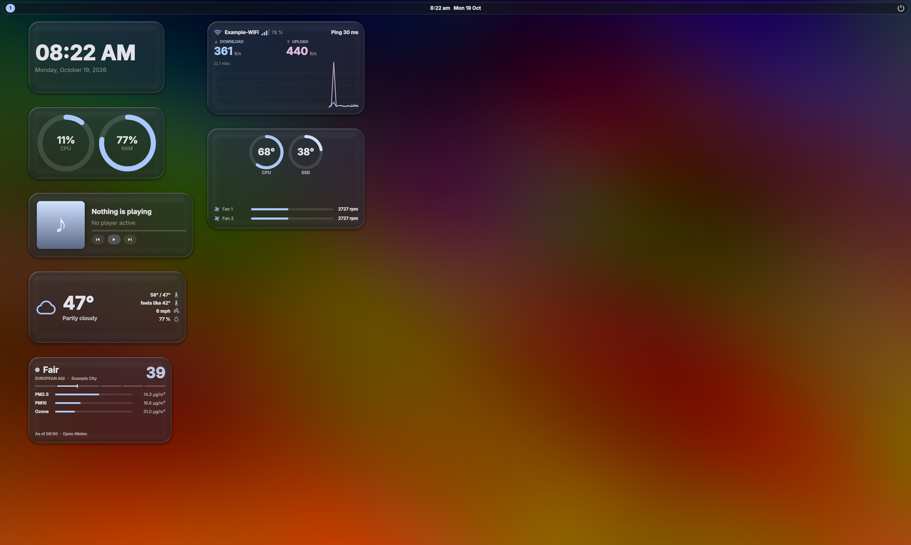
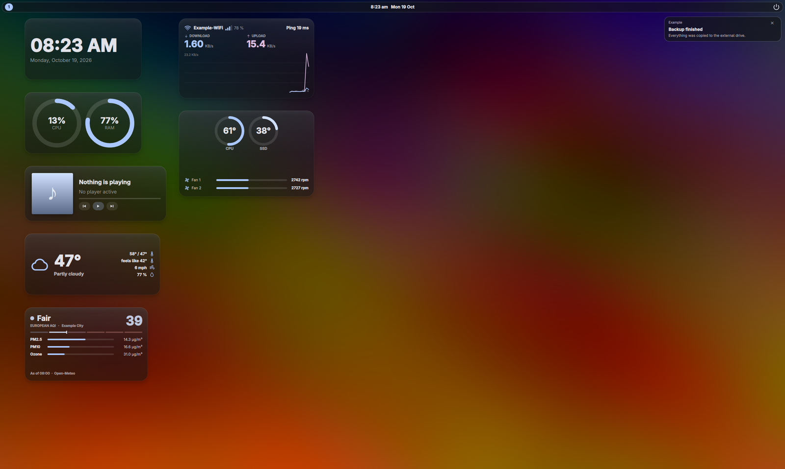
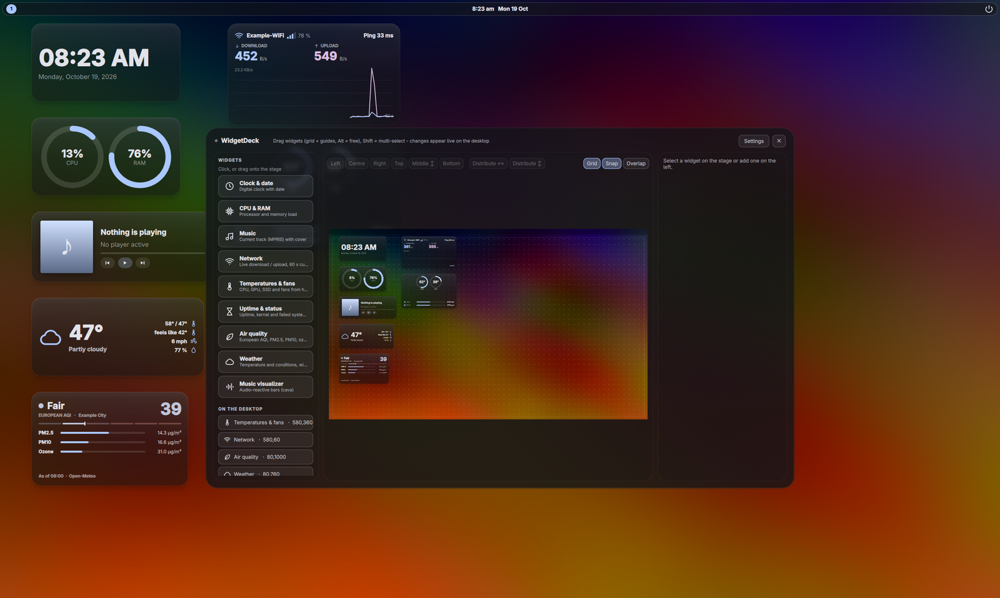
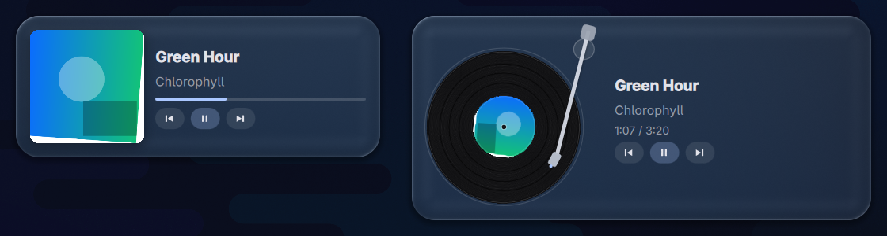
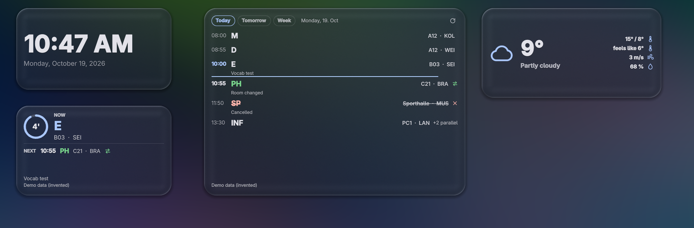
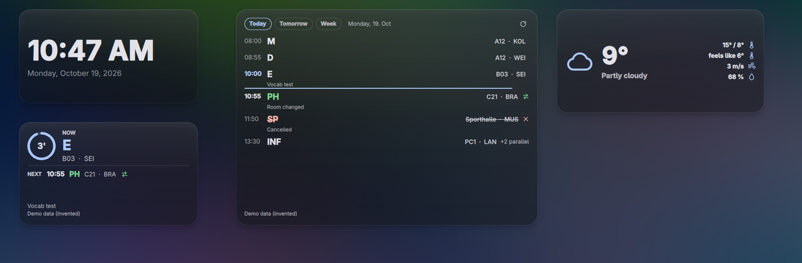
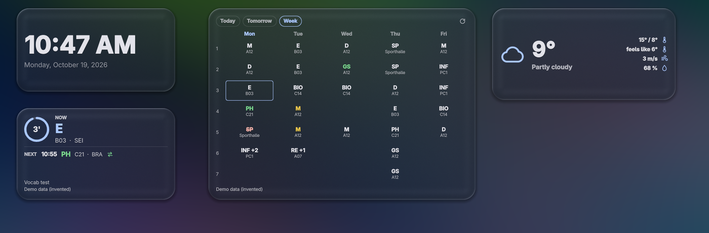

# WidgetDeck

Desktop-Widgets für **Hyprland** unter **Arch Linux** mit Quickshell: Uhr, CPU/RAM, Musik, Visualizer, Netzwerk, Temperaturen, Systemstatus, Luftqualität und Wetter (mit Regen- und Schneepartikeln) im Look **Frosted Glass** oder **Liquid Glass**. Ein eingebauter **Builder** ordnet alles per Maus an: Raster, Hilfslinien, Mehrfachauswahl, Ausrichten und Verteilen.

Es läuft eigenständig: keine Dotfiles des Autors, keine andere Quickshell-Konfiguration, kein Icon-Theme und keine bestimmte Schrift nötig. Optionale Teile (Leiste, Benachrichtigungsdienst mit Power-Menü) sind **standardmäßig aus**.

> English version: [README.md](README.md)

**Unterstützt wird nur Arch Linux** (Hyprland + Quickshell aus den offiziellen Repos).

| Liquid Glass | Frosted Glass |
|---|---|
|  |  |



_Screenshots aus einer sauberen Testsitzung: neutrales Wallpaper, Demo-Standort und -Netzwerkname, keine persönlichen Daten._

## Installation

```bash
git clone https://github.com/Julix2009/WidgetDeck-.git && cd WidgetDeck- && ./install.sh
```

Der Installer fragt, bevor er etwas ändert, das dir gehört. Danach `hyprctl reload` (oder neu anmelden): WidgetDeck startet mit der Sitzung, und einmalig öffnet sich ein kurzer **Einrichtungsassistent** (Wallpaper, Standort, Einheiten, Stil, Größe, Widgets). Nichts braucht einen Neustart oder Handarbeit.

Optionen: `--dry-run`, `--yes`, `--modules widgets,builder,bar,notifications`, `--no-hypr-config`, `--prefix <Ordner>`, `--channel stable`, `--uninstall`.

## Pakete

Alle aus den **offiziellen Repos** (kein AUR): Pflicht `quickshell qt6-declarative qt6-wayland qt6-shadertools jq curl iproute2 iputils`; empfohlen `adwaita-fonts`; optional `networkmanager playerctl cava matugen` (ohne Matugen gilt eine feste Standard-Palette). Icons zeichnet WidgetDeck selbst: kein Icon-Font, kein Icon-Theme.

## Kompatibilität

Getestet: Hyprland **0.55.4** (`hyprland.conf` und Lua), Quickshell 0.3.0 mit Qt 6.11.1, Intel-GPU, awww als Wallpaper-Werkzeug (swww, hyprpaper, swaybg, wpaperd nur mit simulierter Ausgabe), ein echter Monitor plus virtuelle Monitore mit Skalierung 1.5. **Ungetestet:** Hyprland 0.53/0.54 und ältere Versionen (alte Regel-Syntax), AMD- und NVIDIA-GPUs, uwsm. Mehr in der englischen README (Tabelle „Compatibility“).

## Was es ändert – und was nicht

Es legt Programmdateien nach `~/.config/quickshell/widgetdeck/`, drei Befehle nach `~/.local/bin/`, **deine** Einstellungen nach `~/.config/widgetdeck/` (werden nie überschrieben) und Cache/Log nach `~/.cache/widgetdeck/`. Die Hyprland-Regeln stehen in einer **eigenen Datei** `~/.config/hypr/widgetdeck.conf` (bzw. `.lua`); in deine Config kommt nur nach Rückfrage **eine markierte Verweiszeile**, mit Zeitstempel-Backup und vorheriger Prüfung per `Hyprland --verify-config`. Es beendet, deaktiviert oder ersetzt **kein** anderes Programm, ändert sonst nichts an deiner Hyprland-Config, nutzt kein AUR und läuft nicht als root.

**Netzwerk** (alles optional): Wetter von open-meteo.com (nur Koordinaten). Der Standort kann einmalig per IP über ipwho.is bestimmt werden (eine Woche gespeichert) – der Assistent erklärt es, du kannst auch Koordinaten eintragen oder das Wetter abschalten. Der tägliche Update-Check macht `git ls-remote` auf dieses Repo und lässt sich abschalten.

## Module

Widgets (an), Builder und Raster (an), Leiste (**aus**), Benachrichtigungen und Power-Menü (**aus**). Auswahl beim Installieren (`--modules`) oder später im Builder unter *Einstellungen → Module*, oder `widgetdeck module bar on|off`. Vor Leiste und Benachrichtigungsdienst sucht WidgetDeck nach waybar, ags, eww, hyprpanel, dunst, mako, swaync u. Ä., sagt dir, was du zuerst abschalten musst, und **beendet nie selbst etwas**. Die Widgets laufen auch ohne Leiste; alles ist per IPC erreichbar (`widgetdeck ipc powerPanel` usw.), die Regeldatei enthält auskommentierte Beispiel-Binds.

## Erster Start und Alltag

`widgetdeck builder` öffnet den Editor (Alt = freies Ziehen, Shift = Mehrfachauswahl). Den Assistenten startest du erneut mit `widgetdeck wizard`. **Liquid Glass** bricht dein Wallpaper und braucht deshalb die Bilddatei (automatisch bei awww, swww, hyprpaper, swaybg, wpaperd; sonst Bild wählen); ohne Wallpaper oder Shader nutzen alle Widgets Frosted Glass.

**Setup prüfen:** `widgetdeck-doctor` gibt OK / WARN / FAIL mit Lösungsvorschlag aus. Die Ausgabe verbirgt dein Home-Verzeichnis und enthält weder Standort noch Wallpaper-Pfad – du kannst sie in ein GitHub-Issue kopieren.

## Musik-Widget: zwei Stile


_Demo-Daten (erfunden), neutraler Hintergrund._

Das Musik-Widget zeigt den aktuellen Titel eines beliebigen MPRIS-Players. Die Option **Stil** (Widget-Einstellungen im Builder) schaltet live und mit Überblendung zwischen **Normal** (Cover, Fortschrittsbalken, Tasten) und **Schallplattenspieler** um: eine drehende Platte mit Rillen und dem Cover als Label, ein Tonarm, der beim Start auf die Platte schwenkt, dem Fortschritt folgt und bei Pause oder Songwechsel abhebt, daneben Titel, Interpret, Zeit und Tasten (klein: darunter, Tasten beim Darüberfahren). Ein Klick auf Platte oder Tonarm schaltet Play/Pause. Optionen: Drehzahl (33 / 45 U/min), Tonarm folgt dem Fortschritt, Vinyl-Farbe (Schwarz / aus dem Cover), Lichtreflex. Beide Stile lesen denselben Zustand, das Glas dahinter ist in beiden die gemeinsame Glas-Komponente. Bei Pause, ohne Player oder wenn das Widget nicht sichtbar ist, läuft nichts. Die Größen stellst du mit *Klein / Groß* im Builder passend zum gewählten Stil ein.

## Stundenplan-Widget (WebUntis / Untis Mobile)




_Demo-Daten (erfunden), neutrales Wallpaper._

Zeigt deinen eigenen WebUntis-Stundenplan: aktuelle und nächste Stunde (kleines Layout) oder Tageszeitleiste und Wochenraster (großes Layout; Widget größer ziehen oder die Knöpfe *Small / Large* im Builder). Entfall ist rot durchgestrichen, Vertretung grün, Prüfung gelb; parallele Gruppen werden zusammengefasst (`+2 parallel`, eigene Gruppe in den Widget-Eigenschaften wählen); Pausen, Freistunden, Wochenende und Ferien erkennt es am Zeitraster der Schule.

Es nutzt den **Untis-Mobile-Zugang** deines eigenen Kontos - oft der einzige Zugang, weil der normale Login hinter einem Microsoft-Login liegt. Einmal einrichten:

1. In WebUntis *Profil → Freigaben → Untis Mobile → Anzeigen* öffnen (der QR-Code). Screenshot oder Foto **lokal** speichern.
2. `widgetdeck-untis-setup` ausführen und den Pfad der Bilddatei angeben (oder die Werte von Hand eintippen). Es liest den QR-Code mit `zbarimg` (Paket `zbar`), prüft den Zugang mit einem Login und legt den Schlüssel im **Schlüsselbund** ab (Secret Service, über `secret-tool` aus `libsecret`).
3. Das Bild vom Setup löschen lassen und andere Kopien entfernen (Downloads, Papierkorb, Cloud-Sync). Wer das Bild hat, kann deinen Stundenplan lesen.
4. Das Widget *Stundenplan* im Builder hinzufügen (oder im Einrichtungsassistenten ankreuzen).

Pakete (offizielle Repos): `python`, `zbar`, `libsecret`, dazu ein laufender Secret Service (gnome-keyring, KeePassXC mit aktiviertem Secret Service, KWallet). Ohne Secret Service bietet das Setup eine private Datei (`chmod 600`) außerhalb des Repos an - nur mit deiner Zustimmung.

**Was gelesen wird:** nur dein eigener Stundenplan (Stunden, Entfall, Vertretung, Raum, Lehrkräfte- und Klassen-Kürzel, Gruppe, kurze Notiz, Prüfungsmarkierung) und das Zeitraster der Schule, über die Untis-Mobile-Schnittstelle (`getUserData2017`, `getTimetable`). **Nie gelesen:** Noten, Abwesenheiten, Hausaufgaben, Nachrichten, Schülernummern, Namen oder E-Mail-Adressen (solche Texte werden entfernt, bevor etwas gespeichert wird). Abruf alle 15 Minuten, solange das Widget sichtbar ist; Cache mit Zeitstempel (`~/.cache/widgetdeck/timetable.json`, Modus 600); offline steht „As of HH:MM“. Der Schlüssel steht nie im Code, in Configs, Logs oder der Kommandozeile: Der Server bekommt nur einen aus ihm berechneten Einmalcode, per HTTPS mit Zertifikatsprüfung. Wird der Schlüssel widerrufen („Geräte abmelden“ in WebUntis), zeigt das Widget „Zugang abgelaufen, bitte neu einrichten“ und behält den letzten Stand. `widgetdeck-untis-setup --remove` löscht Schlüssel und Cache.

Die Schnittstelle ist die der Untis-Mobile-App, nicht offiziell dokumentiert, und eine Schule kann sie abschalten. Erlaubt deine Schule das nicht, sagt das Setup es („Der Server hat den Zugang verweigert“) und speichert nichts. `widgetdeck-doctor` prüft Secret Service, ob ein Schlüssel existiert (ja/nein), ob der Server antwortet und ob der letzte Abruf geklappt hat. Für Screenshots und Tests gibt es die Datenquelle *Demo (erfundene Stunden)*.

## Updates

```bash
widgetdeck-update
```

Der Befehl wird bei der Installation nach `~/.local/bin` gelegt. Er holt den Remote-Stand, zeigt die **Änderungen seit deiner Version** (aus dem Änderungsprotokoll) und fragt, ob aktualisiert werden soll. Danach werden Programmdateien ersetzt, der Shader neu vorkompiliert, fehlende Pakete nach Rückfrage über `pacman` nachinstalliert und die Widgets neu gestartet.

| Befehl | Wirkung |
|---|---|
| `widgetdeck-update --yes` | ohne Rückfrage |
| `widgetdeck-update --dry-run` | zeigt nur, was passieren würde |
| `widgetdeck-update --channel stable` | ab jetzt nur getaggte Releases (`--channel main` = immer der neueste Stand, Standard) |
| `widgetdeck-update --version v0.2.0` | eine bestimmte Version installieren |
| `widgetdeck-update --rollback` | zurück auf die Version vor dem letzten Update, inklusive Backup der Einstellungen |

**Deine Einstellungen bleiben erhalten.** Ein Update berührt nur Programmdateien. Alles in `~/.config/widgetdeck/` (Layout, Positionen, Glas-Regler, Standort) bleibt, wie es ist. Ändert sich das Format, laufen nummerierte Migrationen (`migrations/`) automatisch in der richtigen Reihenfolge – vorher entsteht ein Backup `~/.config/widgetdeck.bak-<Datum>`, und fehlende neue Einstellungen werden mit Standardwerten ergänzt, ohne vorhandene zu überschreiben. Schlägt etwas fehl, wird die vorherige Version samt Einstellungen automatisch wiederhergestellt.

**Eigene Änderungen an Dateien** im geklonten Ordner erkennt das Skript: Es bietet an, sie per `git stash` zu sichern oder als Kopie mit Zeitstempel abzulegen, und aktualisiert erst danach. Selbst bearbeitete installierte Programmdateien werden vor dem Ersetzen nach `~/.cache/widgetdeck/program-backup-<Datum>` kopiert. Änderungen an den Hyprland-Regeln landen nur in `~/.config/hypr/widgetdeck.conf` (bzw. `.lua`), nie in deiner Hauptconfig.

**Hinweis in der Oberfläche:** Im Builder unter *Einstellungen → Version & Updates* steht die Version, daneben „Auf Updates prüfen“. Gibt es eine neuere Version, erscheint „Update verfügbar“ mit dem Änderungsprotokoll-Auszug und einem Knopf, der `widgetdeck-update` in einem Terminal öffnet. Die Prüfung läuft im Hintergrund höchstens einmal pro Tag (`git ls-remote`, ohne API-Token), blockiert nichts und bleibt still, wenn du offline bist oder keinen Zugriff auf das Repository hast. Es wird **nie** automatisch installiert. Abschalten: Schalter „Täglich nach Updates suchen“ oder `"update": { "check": false }` in `~/.config/widgetdeck/config.json`.

## Deinstallation

```bash
./uninstall.sh          # entfernt nur, was installiert wurde; fragt, ob deine Einstellungen gelöscht werden sollen
```

Die Hyprland-Config wird aus dem Backup zurückgesetzt (wenn du sie seitdem nicht geändert hast; sonst wird nur die markierte Zeile entfernt). Mit `--purge` gehen auch Einstellungen und Cache weg.

## Für Betreuer: neue Version veröffentlichen

Im geklonten Repo, auf dem Branch `main` und mit sauberem Arbeitsbaum:

```bash
./release.sh patch      # Fehlerbehebung 0.1.0 -> 0.1.1   (minor: neue Funktion, major: grundlegende Änderung)
```

Das Skript prüft zuerst `shellcheck`, einen Secret-Scan (`tools/secret-scan.sh`: persönliche Pfade, Tokens, Koordinaten und alle Wörter aus der nicht eingecheckten Datei `.release-denylist`, über Dateien **und** Historie) und die Raster-Tests. Dann erhöht es `VERSION`, schreibt aus den Commit-Nachrichten einen Entwurf für `CHANGELOG.md` (Präfixe `feat:`/`fix:` sortieren nach *Hinzugefügt*/*Behoben*, alles andere nach *Geändert*; der Entwurf öffnet sich im `$EDITOR`), zeigt Version, Änderungen und geänderte Dateien und fragt. Erst nach „j“ wird committet, mit `vX.Y.Z` getaggt und `main` samt Tag gepusht. `./release.sh patch --dry-run` zeigt nur, was passieren würde. Die allererste Veröffentlichung (Version steht schon in `VERSION`): `./release.sh current`.

* Ändert sich das Format der Einstellungen, lege vorher `migrations/000N_name.sh` an (Vorlage und Regeln: `migrations/README.md`) und erhöhe damit die Schema-Nummer.
* `shellcheck` und `gitleaks` installierst du mit `sudo pacman -S shellcheck gitleaks`. Nur wenn das nicht geht: `--no-shellcheck` (wird in der Zusammenfassung vermerkt).
* Commits tragen deine Git-Identität. Wer seine private Adresse nicht öffentlich haben will, nutzt die GitHub-`noreply`-Adresse (`git config user.email <id>+<name>@users.noreply.github.com`).

**Fehler in einem Release zurücknehmen:** Lösche den Tag nicht heimlich, sondern behebe den Fehler mit einem normalen Commit (`git revert <commit>` oder ein Fix) und veröffentliche sofort ein neues Patch-Release mit `./release.sh patch`. Wer das fehlerhafte Release schon hat, bekommt den Fix mit `widgetdeck-update`, oder geht mit `widgetdeck-update --rollback` auf den Stand davor zurück. Nur wenn ein Release gar nicht erscheinen durfte (etwa weil es ein Geheimnis enthielt): Tag entfernen (`git push origin :refs/tags/vX.Y.Z`), Geheimnis sofort ungültig machen und die Historie bereinigen – ein Secret gilt nach dem Push als bekannt.

## Fehlersuche

| Problem | Lösung |
|---|---|
| Es erscheint nichts | `widgetdeck-doctor`; läuft der Daemon (`widgetdeck status`)? `hyprctl reload` ausgeführt? `~/.local/bin` im `PATH`? |
| Glas sieht flach aus | Frosted: `decoration { blur { enabled = true } }` und Regeldatei eingebunden? Liquid: `widgetdeck-doctor` (Shader / Wallpaper); `pacman -S qt6-shadertools` |
| Falscher Wetter-Ort | Einstellungen → Standort: Koordinaten eintragen oder den Assistenten erneut starten |
| Builder-Fenster gekachelt | Regeldatei nicht eingebunden: `./install.sh` erneut ausführen |

## Lizenzen

Eigener Code: MIT (`LICENSE`). Der Liquid-Glass-Shader ist abgeleitet von `liquidglass.frag` aus [MacShell](https://github.com/0-ss/MacShell) (MIT, © 2026 Rickky), siehe `NOTICE.md` und `LICENSES/`. Wetterdaten: Open-Meteo (CC BY 4.0). Schriften und Icon-Sets werden nicht mitgeliefert.
