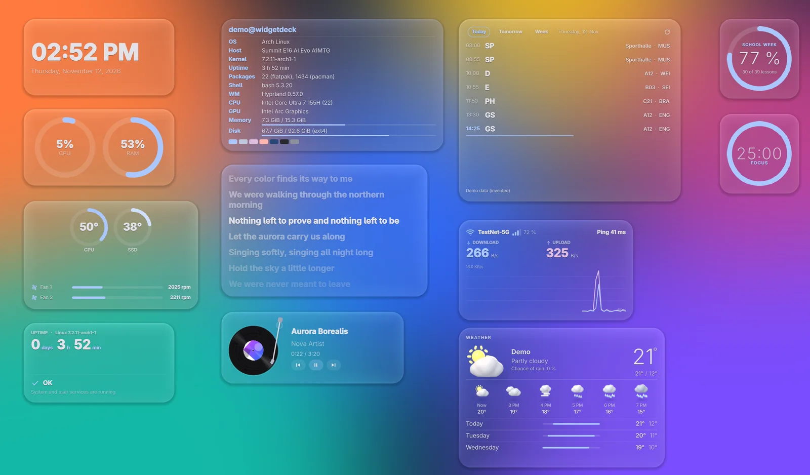
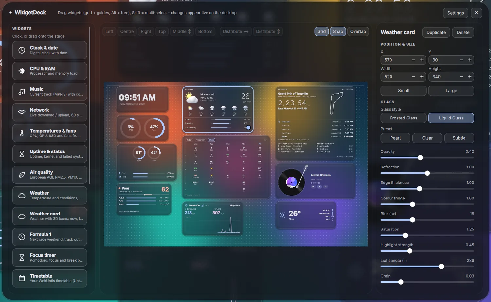
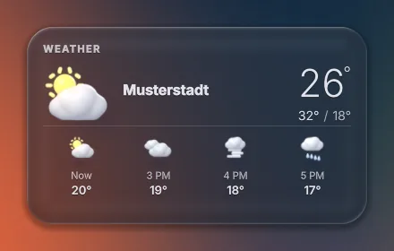
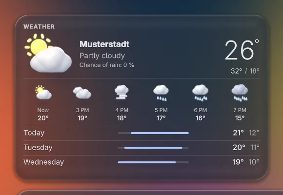
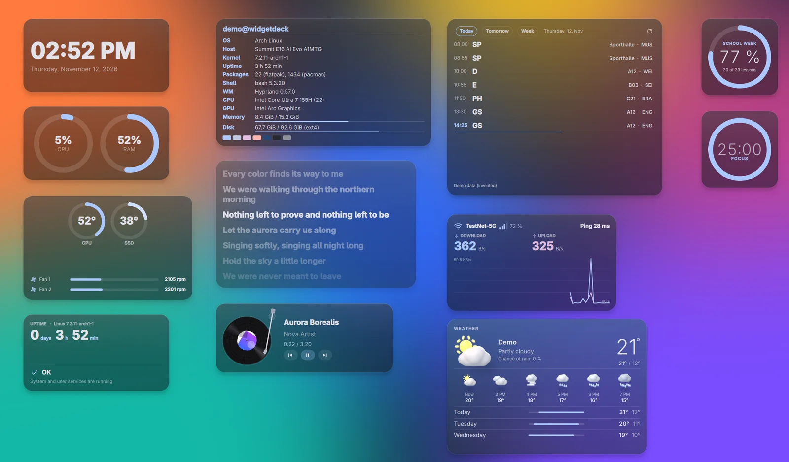
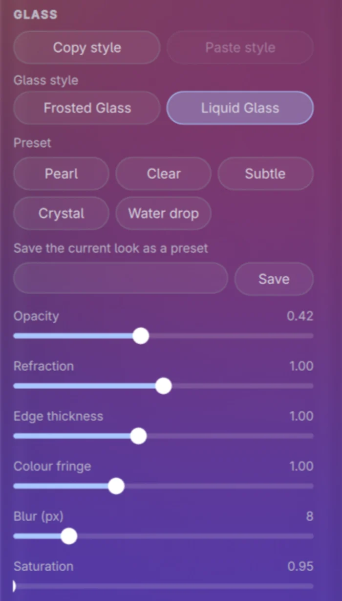
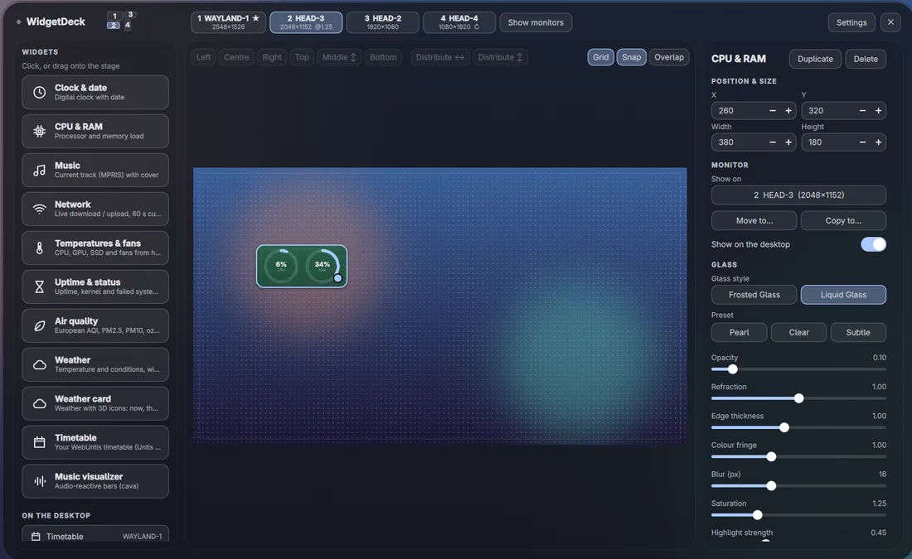

# WidgetDeck

[Deutsche Version](README.md)

Desktop widgets for **Hyprland** on **Arch Linux**, built with Quickshell: clock, weather, music, system values, timetable, focus timer and more, in **Frosted Glass** or **Liquid Glass** style. A built-in builder lets you arrange everything with the mouse.



> Unofficial hobby project, not affiliated with Formula 1, Untis, Apple or any other trademark owner named here. The screenshots show invented demo data.

**Version** 0.8.0 · **Licence** MIT · **Supported:** Arch Linux with Hyprland and Quickshell only

```bash
git clone https://github.com/Julix2009/WidgetDeck-.git
cd WidgetDeck-
./install.sh
```

The detailed documents in `docs/` are currently written in German only.

## Contents

- [Features at a glance](#features-at-a-glance)
- [Requirements](#requirements)
- [Installation](#installation)
- [First start](#first-start)
- [Usage](#usage)
- [Widgets in detail](#widgets-in-detail)
- [Privacy and security](#privacy-and-security)
- [Updates and removal](#updates-and-removal)
- [Troubleshooting](#troubleshooting)
- [Project structure](#project-structure)
- [Contributing, licence and credits](#contributing-licence-and-credits)

## Features at a glance

- **Builder** with snap grid, guides, multi-select, align and distribute
- **Two glass styles:** Frosted Glass and Liquid Glass (own shader that refracts the wallpaper), set per widget; Liquid Glass has presets and an optional **edge lens** (the rim bends the background like a drop of water)
- **Copy and paste style:** carry the look of one widget over to others, also to several at once
- **Theming** with Matugen: colours follow the wallpaper (optional, otherwise a fixed default palette)
- **Several monitors** with a stable monitor key, own layout and wallpaper per monitor
- **Sizes:** widgets with two sizes switch between *Small* and *Large* with an animation
- **Modules:** bar and notifications with power menu are included but **off** by default
- **Lean:** all widgets run in one single process; the builder is only loaded while it is open
- **Self-contained:** no foreign dotfiles, no icon theme and no particular font needed; the interface is available in English and German

| Widget | Shows | Sizes | Notes, needs |
|---|---|---|---|
| Clock & date | digital clock with date | default | – |
| CPU & RAM | load as rings or bars | default | – |
| Music | current track, style Normal or Turntable | Small / Large | MPRIS player; `playerctl` optional |
| Network | live down/upload, 60 s curve, Wi-Fi, ping | default | `iproute2`, `iputils`; `networkmanager` optional; pings `1.1.1.1` by default |
| Temperatures & fans | CPU, GPU, SSD, fans | default | hwmon sensors; missing ones are left out |
| Uptime & status | uptime, kernel, failed systemd services | default | systemd |
| Air quality | European AQI, PM2.5, PM10, ozone | default | internet (Open-Meteo) |
| Weather | temperature and conditions, rain and snow particles (Liquid Glass only) | default | internet (Open-Meteo) |
| Weather card | 3D icons, next hours and days | Small / Large | internet (Open-Meteo), same data as *Weather* |
| Formula 1 (unofficial) | next race weekend, result, standings | Small / Large | `python`, internet (Jolpica-F1, OpenF1) |
| Focus timer | Pomodoro ring with sessions | Small / Large | `focus-timer` command; sound and notification optional |
| School progress | how many percent of the school day or week are over | Standard | data of the timetable widget |
| Timetable | WebUntis through the Untis Mobile access | Small / Large | `python`, `zbar`, `libsecret`, Secret Service |
| Music visualizer | audio-reactive bars | default | `cava` |
| Lyrics | synchronised lyrics of the playing song, the line being sung lights up like on Spotify | default | MPRIS player, internet ([LRCLIB](https://lrclib.net)) |
| System info | fastfetch-style overview: system, kernel, uptime, packages, CPU, GPU, memory, disk, small logo | default | `fastfetch` |

Pixel sizes and all settings are listed in [docs/widgets.md](docs/widgets.md) (German).

## Requirements

| Component | Status |
|---|---|
| System | Arch Linux (or a derivative with `ID_LIKE=arch`); the installer stops otherwise and refuses to run as root |
| Hyprland | tested with **0.55.4** (also in use on 0.57), configured as `hyprland.conf` (hyprlang) and as Lua `hyprland.lua` (from 0.55). From 0.53 the block rule syntax applies (untested), below that the old syntax (untested). Below 0.40 the installer stops. |
| Quickshell | tested with **0.3.0** (git build `quickshell-git`); the installer warns below 0.2.0 |
| Qt | 6.7 or newer, tested with 6.11.1 |
| GPU | tested with Intel Arc; AMD and NVIDIA are **untested**. Liquid Glass needs the shader (`qsb`); without it every widget uses Frosted Glass. |
| Wallpaper | for Liquid Glass detected through awww (tested), swww, hyprpaper, swaybg, wpaperd (simulated only) or a picture you choose |

All packages come from the **official repositories**; no AUR package is needed, and the installer never installs anything from the AUR.

**Required:** `quickshell qt6-declarative qt6-wayland qt6-shadertools jq curl iproute2 iputils`. **Recommended:** `adwaita-fonts` (without it WidgetDeck uses the next installed font).

| Feature | Package | Repository |
|---|---|---|
| Wi-Fi name in the network widget | `networkmanager` | extra |
| Skip direction in the music widget | `playerctl` | extra |
| Music visualizer | `cava` | extra |
| System info widget | `fastfetch` | extra |
| Colours from the wallpaper | `matugen` | extra |
| Formula 1 and timetable widgets | `python` | core |
| Read the QR code (timetable) | `zbar` | extra |
| Keyring (timetable) | `libsecret`, plus a Secret Service such as `gnome-keyring` | core, extra |
| Notifications (Formula 1 reminder, focus timer) | `libnotify` | extra |
| Focus timer sound | one of `pipewire-audio`, `libpulse`, `alsa-utils` | extra |
| Country flag in the Formula 1 widget | `noto-fonts-emoji` | extra |

The installer offers `python`, `zbar`, `libsecret`, `networkmanager`, `playerctl`, `cava`, `fastfetch` and `matugen`; install the other packages of the table yourself.

## Installation

The shortest way:

```bash
git clone https://github.com/Julix2009/WidgetDeck-.git
cd WidgetDeck-
./install.sh
```

The installer checks the system, offers missing packages (`sudo pacman -S --needed`, after asking), asks for the modules, copies the program, compiles the Liquid Glass shaders and sets up the Hyprland rules. Then:

```bash
hyprctl reload
widgetdeck builder
```

`hyprctl reload` loads the rules (blur, window rules). Hyprland runs the autostart (`exec-once`) **only at startup**, so `hyprctl reload` does not start WidgetDeck. `widgetdeck builder` starts the daemon immediately and opens the builder; at the next login it starts on its own.

To only see what would happen (changes nothing):

```bash
./install.sh --dry-run
```

### Options

| Option | Effect |
|---|---|
| `--dry-run` | shows what would happen and changes nothing |
| `--yes`, `-y` | no questions: required and recommended packages are installed, optional ones are not, the include line is added to your Hyprland config |
| `--modules <list>` | `widgets,builder,bar,notifications` (default: `widgets,builder`) |
| `--no-hypr-config` | does not touch your Hyprland config and only shows what to add |
| `--no-packages` | skips the package check |
| `--prefix <dir>` | test installation: the folder replaces your home (config, cache, program and Hyprland files live below it) |
| `--channel main\|stable` | update channel: `main` (default, newest state) or `stable` (tagged releases only) |
| `--uninstall`, `--purge` | see [Updates and removal](#updates-and-removal) |
| `--help`, `--version` | help, version |

### What the installer changes and what it does not

| What | Where |
|---|---|
| Program files | `~/.config/quickshell/widgetdeck/` (start manually with `qs -c widgetdeck`) |
| Commands | `~/.local/bin/`: `widgetdeck`, `widgetdeck-update`, `widgetdeck-doctor`, `widgetdeck-untis-setup`, `focus-timer` |
| Your settings | `~/.config/widgetdeck/`; `config.json` is only created when missing and never overwritten |
| Hyprland rules | a **separate file** `~/.config/hypr/widgetdeck.conf` (`widgetdeck.lua` for Lua) |
| Hyprland include line | **one marked line** in `hyprland.conf` (or `hyprland.lua`), only after you agree, with a backup `<file>.widgetdeck-backup-<timestamp>` and a check with `Hyprland --verify-config` first |
| Matugen | one marked block in `~/.config/matugen/config.toml` plus a template, only if `matugen` is installed and you agree (backup as above) |
| Cache and log | `~/.cache/widgetdeck/` |

Paths follow `XDG_CONFIG_HOME` and `XDG_CACHE_HOME` when set. The installer does not stop, disable or replace any other program, changes nothing else in your Hyprland config and does not run as root (it only calls `pacman` through `sudo`). A read-only config or one linked into the Nix store is left alone and the lines are only shown.

### Optional: build a package

A pacman package can be built from a clone. `./install.sh` remains the recommended way.

```bash
cd packaging
makepkg -si
```

The package puts the files into `/usr/share/widgetdeck/` and the commands `widgetdeck`, `widgetdeck-doctor`, `widgetdeck-untis-setup` and `focus-timer` into `/usr/bin/`. It sets up **no** Hyprland rules (the templates are in `/usr/share/widgetdeck/hypr/`, the placeholder `@BIN@` stands for `/usr/bin/widgetdeck`) and contains no `widgetdeck-update`. The `PKGBUILD` is not in the AUR.

## First start

On the first start a setup assistant opens once. You can skip it and run it again with `widgetdeck wizard` or in the builder under *Settings → Run the setup assistant again*.

1. **Wallpaper:** WidgetDeck looks for it in awww, swww, hyprpaper, swaybg and wpaperd. If it finds nothing you choose a picture; without a wallpaper Liquid Glass is off.
2. **Location** for weather and air quality: *Automatic* (your IP address goes to ipwho.is once a week, see [Privacy](#privacy-and-security)), *Enter it* (coordinates, nothing is looked up) or *No weather*.
3. **Units and language:** °C/°F, 24 h/12 h, English or German (default: like the system).
4. **Look:** *Standard (Frosted)* or *Liquid Glass*, plus the widget size (Small, Medium, Large).
5. **Widgets:** pick what you want. For the timetable there is a *Set up the timetable access …* button (see [timetable](#widgets-in-detail)).

## Usage



`widgetdeck toggle` opens and closes the builder (edit mode). On the desktop itself the widgets take no clicks.

| Action | How |
|---|---|
| Add a widget | click it on the left or drag it onto the stage |
| Move | drag; grid and guides snap, `Alt` for free placement, `Shift` for multi-select |
| Arrow keys | one grid cell, five with `Shift`; `Delete` removes the selection, `Esc` closes |
| Align, distribute | bar on top: Left, Centre, Right, Top, Middle ↕, Bottom, Distribute ↔ and ↕ (wraps to a second line in a narrow window) |
| Grid | switches *Grid*, *Snap*, *Overlap* at the top right; grid size and edge distance under *Settings* |
| Size | width and height in the panel on the right; *Small* / *Large* switches with an animation (widgets with two sizes only) |
| Duplicate, delete | buttons at the top of the panel on the right |
| Carry a style over | *Copy style* / *Paste style* in the *Glass* section, or `Ctrl+Shift+C` / `V` (also `Ctrl+C` / `V` while no text field has the focus); pasting onto several selected widgets applies the style to all of them |
| Modules | *Settings → Modules* or `widgetdeck module bar on` (`widgets`, `builder`, `bar`, `notifications`) |

 

### Glass styles

| | Frosted Glass | Liquid Glass |
|---|---|---|
| Effect | background blur from Hyprland | own shader that refracts the wallpaper |
| Needs | blur in Hyprland (default) and the rules file | `qsb` (`qt6-shadertools`) and a detected wallpaper |
| If missing | – | every widget falls back to Frosted Glass |
| Settings | tint, border, opacity, shine | presets *Pearl*, *Clear*, *Subtle*, *Crystal*, *Water drop* (plus your own presets) and sliders for opacity, refraction, edge thickness, colour fringe, blur, saturation, highlight, light angle, grain; plus the *Edge lens* |



You set the style and sliders per widget in the right panel under *Glass style* (to edit Liquid Glass: pick a preset, then adjust the sliders). The preset buttons wrap onto several lines when needed:



**Your own presets:** *Save the current look as a preset* stores all Liquid Glass values of the widget under a name (corner radius and merging belong to the widget and are left out). The presets appear under *Your presets*; a click applies one, the small ✕ deletes it. They are kept in `config.json` under `user_presets`.

**Edge lens (Liquid Glass):** the *Edge lens* section with the *Lens strength* slider is off at first (0): every widget then looks as before. With a strength above 0 the rim bends the background inwards and splits it into a faint rainbow fringe, with a bright edge along the top and a soft shadow along the bottom. *Edge bending*, *Rainbow fringe* and *Lens tint* only appear once the lens is on. *Crystal* is clear glass with a bright rim, *Water drop* a drop of water with a soft glow instead of a white outline. The lower the *Lens tint*, the more see-through the glass.

### Several monitors



WidgetDeck finds monitors by itself and remembers them by a stable key (make, model, serial, else the description; the connector name alone is never the identity). With several monitors the builder shows a monitor strip on top and a *Show monitors* button. Per widget the panel offers *Show on* (one monitor, *Primary monitor* or *All monitors*), *Move to …*, *Copy to …* and the switch *Show on the desktop* to hide and show a widget. Widgets of an unplugged monitor are not deleted: they wait (default) or move to the main monitor and come back. Data is fetched once, not per monitor.

### Commands

| Command | Effect |
|---|---|
| `widgetdeck daemon` | starts the widgets in the foreground (for autostart) |
| `widgetdeck builder`, `toggle`, `close` | open the builder (starts the daemon if needed), toggle, close |
| `widgetdeck stop`, `restart`, `log` | stop, restart, shell log |
| `widgetdeck status` | exit code 0 when the daemon is running |
| `widgetdeck wizard` | show the setup assistant again |
| `widgetdeck module <name> on\|off` | switch a module |
| `widgetdeck config` | print the path of `widgets.json` |
| `widgetdeck ipc <function> [args]` | raw IPC call, for example `ping`, `list`, `powerPanel`, `toggleDnd`, `dismissNotifications`, `reloadWallpaper`; all functions are in `qml/shell.qml` |
| `widgetdeck-doctor` | checks the setup (also `widgetdeck doctor`) |
| `widgetdeck-update` | updates, see [Updates](#updates-and-removal) |
| `widgetdeck-untis-setup` | connects the timetable widget (`--remove` deletes the access) |
| `focus-timer toggle\|start\|pause\|reset\|skip\|status [--json]` | controls the focus timer, for example from a key bind |

### Example key binds

The rules file contains these lines commented out (`widgetdeck.conf` with `bind = …`, `widgetdeck.lua` with `hl.bind(…)`).

`hyprland.conf`:

```ini
bind = SUPER, W, exec, widgetdeck toggle
bind = SUPER SHIFT, P, exec, widgetdeck ipc powerPanel
bind = SUPER, N, exec, widgetdeck ipc toggleDnd
bind = SUPER, F, exec, focus-timer toggle
bind = SUPER SHIFT, F, exec, focus-timer skip
```

`hyprland.lua` (Hyprland 0.55 or newer):

```lua
hl.bind("SUPER + W", hl.dsp.exec_cmd("widgetdeck toggle"))
hl.bind("SUPER + SHIFT + P", hl.dsp.exec_cmd("widgetdeck ipc powerPanel"))
hl.bind("SUPER + N", hl.dsp.exec_cmd("widgetdeck ipc toggleDnd"))
hl.bind("SUPER + F", hl.dsp.exec_cmd("focus-timer toggle"))
hl.bind("SUPER + SHIFT + F", hl.dsp.exec_cmd("focus-timer skip"))
```

`powerPanel` needs the bar or the notifications module, `toggleDnd` the notifications module. If `~/.local/bin` is not in Hyprland's `PATH`, write the full path (`$HOME/.local/bin/focus-timer`).

## Widgets in detail

All settings, keys and defaults are in [docs/widgets.md](docs/widgets.md) (German). The essentials:

<details>
<summary>Clock, CPU & RAM, temperatures, uptime</summary>

- **Purpose:** system values at a glance. The data is local (`/proc`, `/sys/class/hwmon`, systemd); no network access.
- **Settings:** formats, rings or bars, temperature warning threshold.
- **Note:** missing sensors or fans are left out.

</details>

<details>
<summary>Network</summary>

- **Purpose:** down and upload, 60 s curve, Wi-Fi name and signal, ping; all colours (download, upload, Wi-Fi, ping, error) are adjustable, as a theme role or a custom colour.
- **Source:** `ip`, `ping` every 3 s, `nmcli` every 5 s (optional).
- **Setting:** the ping target (default `1.1.1.1`).

</details>

<details>
<summary>Weather, weather card, air quality</summary>

- **Source:** Open-Meteo, no key; only coordinates are sent. Weather and weather card share one request per 10 minutes, air quality asks every 30 minutes.
- **Weather card:** 3D icons (16 icon sets, own Blender renders, included in the repository), large size with 4 to 8 hours and 3 to 7 days.
- **Note:** offline, the last values stay with "As of HH:MM".

</details>

<details>
<summary>Music, music visualizer</summary>

- **Music:** shows the track of any MPRIS player; style *Normal* or *Turntable* (speed, tonearm follows the progress, vinyl colour).
- **Visualizer:** bars through `cava` and PipeWire, one `cava` for all visualizers with the same settings.

</details>

<details>
<summary>Focus timer</summary>

- **Purpose:** Pomodoro with focus (25 min), short break (5 min) and long break (15 min after 4 sessions); all lengths adjustable.
- **One timer for all:** it lives with the shell; hiding the widget or changing monitors does not stop it.
- **Control:** `focus-timer …`, see [Commands](#commands).
- **Optional:** "do not disturb" during focus (WidgetDeck, dunst, mako, swaync), sound and notification at the end of a phase.
- **Data:** statistics in `~/.config/widgetdeck/focus-stats.json`, running state in `focus-state.json`; both stay local.

</details>

<details>
<summary>School progress</summary>

- **Purpose:** shows as a ring how much of the school day or week is over, counted in lessons of the timetable.
- **Data:** uses the data of the timetable widget; without a timetable there is nothing to count.

</details>

<details>
<summary>Lyrics</summary>

- **Purpose:** shows only the text of the playing song, in sync with the playback: the line being sung is bright, the others are dimmed, and the text scrolls along. Instrumental breaks appear as ♪.
- **Data source:** [LRCLIB](https://lrclib.net) (free, no key). One request per song (artist, title, album, length and, as with every connection, your IP address); lyrics that were found are cached for 30 days in `~/.cache/widgetdeck/lyrics/`. The position comes from the MPRIS player.
- **Settings:** text size, alignment, current line in the accent colour, title and artist, player. If a song has no synchronised lyrics, the widget says so.
- **Note:** the lyrics belong to their rights holders; WidgetDeck only shows them on your computer and ships none.

</details>

<details>
<summary>System info (fastfetch)</summary>

- **Purpose:** a fastfetch-style overview: system, kernel, uptime, packages, CPU, GPU, memory, disk, plus a small logo and colour blocks.
- **Data source:** `fastfetch --json`, local, about once a minute while the widget is visible; without `fastfetch` the widget shows a hint.

</details>

<details>
<summary>Timetable (WebUntis, Untis Mobile access)</summary>

The widget shows your own timetable through the Untis Mobile access of your account, often the only option because the normal login sits behind a Microsoft login.

**Setup:**

1. Install `python`, `zbar`, `libsecret` and a Secret Service (gnome-keyring, KeePassXC with Secret Service or KWallet).
2. In WebUntis open *Profile → Releases → Untis Mobile → Show* and save the QR code **locally** as an image.
3. Run `widgetdeck-untis-setup` and give the path of the image. The script reads the QR code, checks the access with one login and stores the key in the keyring.
4. Delete the image and all other copies: anyone with the image can read your timetable.
5. Add the *Timetable* widget in the builder.

**Source:** your school's server through the interface of the Untis Mobile app, every 15 minutes while the widget is visible. Only your timetable and the time grid are read, no marks, absences, homework or messages.

**Notes:** the interface is not officially documented and a school can switch it off; published limits are not known, WidgetDeck throttles itself. If the access expires the widget shows a notice; run `widgetdeck-untis-setup` again.

</details>

<details>
<summary>Formula 1 (unofficial)</summary>

Shows the next race weekend with track outline, countdown, all sessions in local time, last result and driver standings. **Unofficial:** no connection to Formula 1, the FIA, teams or drivers; no logos or images are loaded and nothing is scraped from websites.

**Setup:** none, add the widget (`python` required).

**Sources:** [Jolpica-F1](https://github.com/jolpica/jolpica-f1) (calendar at most once a day, results and standings every 6 hours) and [OpenF1](https://openf1.org) (cancelled races, optional live view, off by default). One shared feed with a cache fetches everything; after errors it waits 5 minutes, doubling up to 2 hours, and obeys HTTP 429 and `Retry-After`.

**Licences:** the Jolpica data is CC BY-NC-SA 4.0 (non-commercial use only, attribution). The track outlines are simplified from bacinger/f1-circuits (MIT). Details in [NOTICE.md](NOTICE.md).

</details>

## Privacy and security

**Local** stay your settings and layout (`~/.config/widgetdeck/`), the focus statistics and the caches (`~/.cache/widgetdeck/`: weather, location, Formula 1, timetable with mode 600). `widgetdeck-untis-setup` stores the Untis key in the keyring (Secret Service); only if you choose so it goes into a private file instead (`~/.local/share/widgetdeck-private/untis.json`, mode 600). The code has no network targets other than the following; there is no telemetry.

| Target | When | What is sent | How to switch off |
|---|---|---|---|
| Open-Meteo (`api.open-meteo.com`, `air-quality-api.open-meteo.com`) | while weather, weather card or air quality are visible | coordinates; the server sees the IP address as with any connection | remove the widgets; choose *No weather* in the assistant |
| LRCLIB (`lrclib.net`) | only with the lyrics widget, once per song (then from the local cache) | artist, title, album and length of the song; the server sees your IP address as with any connection | remove the widget |
| ipwho.is | only with location *Automatic*, after the assistant, at most once a week (the result is stored) | your IP address; the city-level location comes back | enter coordinates yourself or `"location": {"auto": false}` in `config.json` |
| Jolpica-F1, OpenF1 | only with the Formula 1 widget | the request for calendar and results; no personal data besides the IP | remove the widget; live data is off by default |
| Your school's server (WebUntis) | only with the timetable widget, every 15 minutes | your Untis user ID and a one-time code computed from the key (never the key itself), over HTTPS with certificate verification | `widgetdeck-untis-setup --remove`, remove the widget |
| Ping target (network widget) | every 3 seconds | ICMP echo to `1.1.1.1` (changeable) | change the target or remove the widget |
| GitHub (update check) | at most once a day, `git ls-remote` without a token | a Git request to this repository | *Settings → Check for updates daily* off, or `"update": {"check": false}` |

Security: the installer does not run as root and uses `sudo` only for `pacman`. Your Hyprland config is backed up before any change and checked with `Hyprland --verify-config`. `widgetdeck-update` never installs automatically; it shows the changes and asks.

## Updates and removal

```bash
widgetdeck-update              # shows the changes, asks, updates; settings are never touched
widgetdeck-update --rollback   # back to the version before the last update
./uninstall.sh                 # removes what was installed; asks before deleting your settings
```

| Option of `widgetdeck-update` | Effect |
|---|---|
| `--yes`, `-y` | no questions (local changes are saved first) |
| `--dry-run` | shows what would happen |
| `--channel main\|stable` | newest state or tagged releases only (remembered) |
| `--version vX.Y.Z` | install a specific version |
| `--rollback` | back to the previous version, with the settings backup |
| `--no-packages`, `--no-restart` | skip the package check or the restart of the widgets |

`widgetdeck-update` works in the cloned folder: it fetches the remote state, shows the changelog excerpt since your version, replaces the program files, recompiles the shaders and restarts the widgets. If the clone is gone it clones the repository again. In the builder, *Settings → Version & updates* shows a notice when a newer version exists.

- **Your settings stay:** an update only replaces program files. If a format changes, numbered migrations (`migrations/`) run in order; before that a backup `~/.config/widgetdeck.bak-<date>` is made (the five newest are kept). If a migration fails, the settings are restored and the update stops.
- **Local changes** in the clone: the script offers `git stash` or a timestamped copy. Hand-edited installed files are copied to `~/.cache/widgetdeck/program-backup-<date>` before they are replaced.
- **Removal:** `./uninstall.sh` stops the daemon and removes the program, commands, Matugen block and template, and the Hyprland include line (from the backup if you have not changed the file since, otherwise only the marked line). The rules file is only deleted if you did not change it. Your settings are deleted only when you agree; `./uninstall.sh --purge` deletes settings and cache without asking.

## Troubleshooting

Run `widgetdeck-doctor` first: it names a fix for every WARN and FAIL line.

| Symptom | Fix |
|---|---|
| Nothing appears | `widgetdeck status`; `widgetdeck builder` starts the daemon immediately (`hyprctl reload` does not) |
| Liquid Glass looks flat | `sudo pacman -S qt6-shadertools`, then `widgetdeck restart`; `widgetdeck-doctor` shows shader and wallpaper lines |
| Wallpaper not detected | *Settings → Glass background*: choose a picture |
| Wrong weather location | *Settings → Location*: enter coordinates |
| Widgets on the wrong monitor | use *Show on* or *Move to …* in the panel |
| The builder does not open at login | intended: it is only loaded while it is open; `widgetdeck builder` or `widgetdeck toggle` opens it |

All known problems (notification daemon conflict, expired timetable access, key binds without effect …) are in [docs/troubleshooting.md](docs/troubleshooting.md) (German). For an issue, paste the full output of `widgetdeck-doctor --plain` into the [bug report form](https://github.com/Julix2009/WidgetDeck-/issues); the program replaces your home directory with `~` and prints neither location nor wallpaper path.

## Project structure

| Folder, file | Contents |
|---|---|
| `qml/` | the program: `shell.qml`, `core/` (glass, store, monitors, theme), `widgets/`, `builder/`, `wizard/`, `modules/` (bar, notifications, power menu) |
| `bin/` | the commands `widgetdeck`, `widgetdeck-update`, `widgetdeck-doctor`, `widgetdeck-untis-setup`, `focus-timer` |
| `lib/` | shared script parts of installer and updater (packages, Hyprland, migrations, texts) |
| `hypr/` | templates of the Hyprland rules (hyprlang, old syntax, Lua) |
| `migrations/` | numbered migrations of the settings |
| `matugen/` | template for the colour palette |
| `packaging/` | `PKGBUILD` for the optional package route |
| `examples/` | example of a custom widget |
| `tools/` | tests, test session (`tools/nested`), measuring tools, Blender scripts, Formula 1 tools |
| `docs/` | detailed documentation and images |
| `install.sh`, `update.sh`, `uninstall.sh` | installer, updater, removal |
| `LICENSE`, `NOTICE.md`, `LICENSES/` | licence and origin of third-party parts |

**Adding a new widget:** a custom widget only needs to be placed in `~/.config/widgetdeck/widgets/`, a built-in one is an entry in `qml/widgets/Registry.js`. The guide is in [docs/neues-widget.md](docs/neues-widget.md) (German), the rules in [CONTRIBUTING.md](CONTRIBUTING.md).

## Contributing, licence and credits

**Contributing:** bug reports and small fixes help most. The rules and the check commands are in [CONTRIBUTING.md](CONTRIBUTING.md), help in [SUPPORT.md](SUPPORT.md). There is no guaranteed response time.

**Licence:** the own code is under the MIT licence, see [LICENSE](LICENSE). Origin and licences of third-party parts are in [NOTICE.md](NOTICE.md) (German), the full texts in `LICENSES/`.

| Source | Use | Licence |
|---|---|---|
| [MacShell](https://github.com/0-ss/MacShell) | template of the Liquid Glass shader (`glass.frag`) | MIT, © 2026 Rickky |
| [bacinger/f1-circuits](https://github.com/bacinger/f1-circuits) | track outlines (simplified) | MIT, © 2019-2025 Tomislav Bacinger |
| [Open-Meteo](https://open-meteo.com) | weather and air quality | data CC BY 4.0, the free API is meant for non-commercial use |
| [Jolpica-F1](https://github.com/jolpica/jolpica-f1) | race calendar, results, standings | CC BY-NC-SA 4.0 (non-commercial only) |
| [OpenF1](https://openf1.org) | cancelled races, optional live view | unofficial project, licence CC BY-NC-SA 4.0 according to `NOTICE.md` |
| [LRCLIB](https://lrclib.net) | lyrics (synchronised) | free service; the lyrics belong to their rights holders, none are shipped |
| ipwho.is | location by IP | service without a licence statement in the project |

Not bundled: fonts (preferably Adwaita Sans from `adwaita-fonts`, OFL 1.1 according to `NOTICE.md`), emoji data, Blender (only needed to regenerate the weather icons). The icons (`qml/core/Icons.js`), the 3D weather icons and the focus timer sound are own work.

**Trademarks:** "Formula 1", "F1", "FIA" and related marks belong to their owners, as do "Untis" and "WebUntis". "Liquid Glass" is also the name of a design by Apple. WidgetDeck is not affiliated with any of these owners and contains none of their logos or images.
