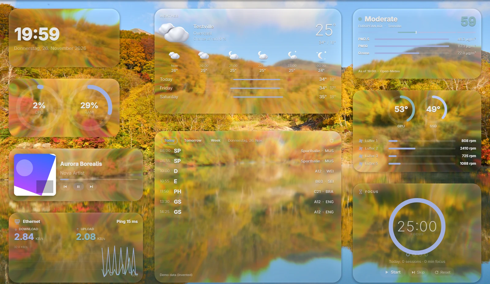
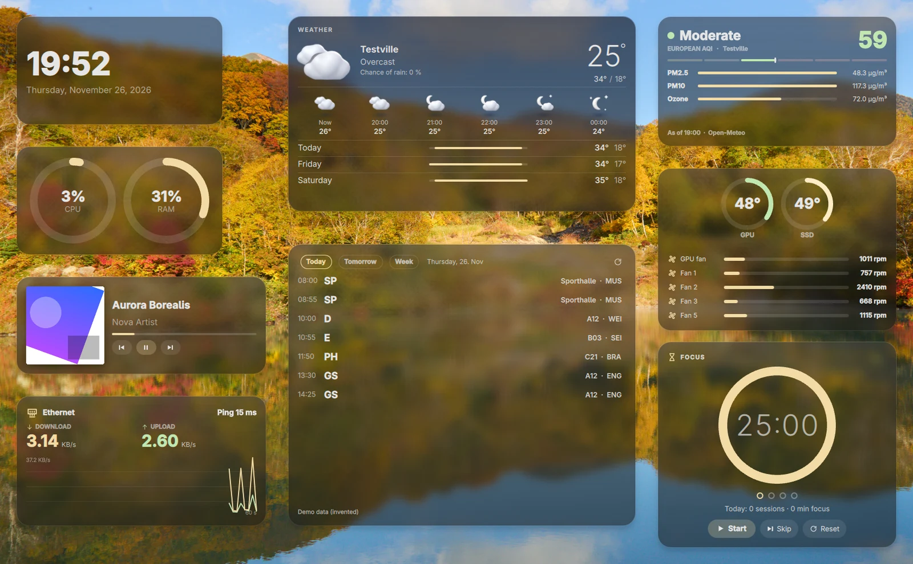
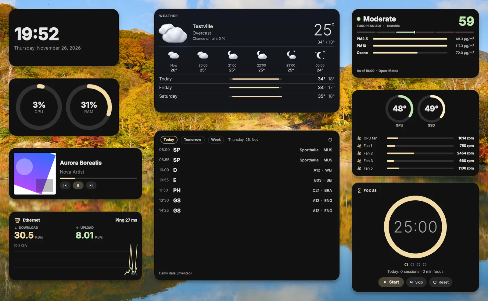

<div align="center">


# WidgetDeck

**Desktop widgets for Hyprland that you put together with the mouse.**<br>
Clock, weather, music, system stats, timetable, Formula 1 and more, in three styles,<br>
with colours that follow your wallpaper or your shell. Built with Quickshell.


<a href="#installation"><b>Installation</b></a>

</div>

---

### Liquid Glass



### Frosted Glass



### Solid



<sub>Demo data. Wallpaper: <a href="https://commons.wikimedia.org/wiki/File:Hakkoda_Mountains,_Part_II-_Foothills_-_Hakkoda6929.jpg">Hakkoda Mountains</a> by lumoplank, CC0.</sub>

## Installation

For **Arch Linux** with **Hyprland** only.

```bash
git clone https://github.com/Julix2009/WidgetDeck-.git
cd WidgetDeck-
./install.sh
```

Then:

```bash
hyprctl reload
widgetdeck builder
```

Update with `widgetdeck-update`, remove with `./uninstall.sh`. `./install.sh --dry-run` only shows what would happen.

---

<sub>[All widgets](docs/widgets.md) · [Troubleshooting](docs/troubleshooting.md) · [Contributing](CONTRIBUTING.md) · [MIT](LICENSE) · [Notices](NOTICE.md)<br>
Unofficial hobby project, not affiliated with Formula 1, Untis, Apple or any other trademark owner named here.</sub>
