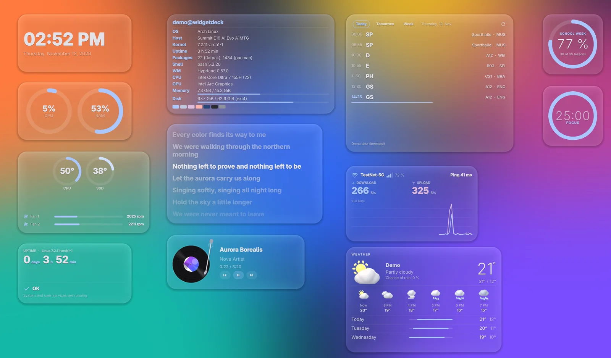
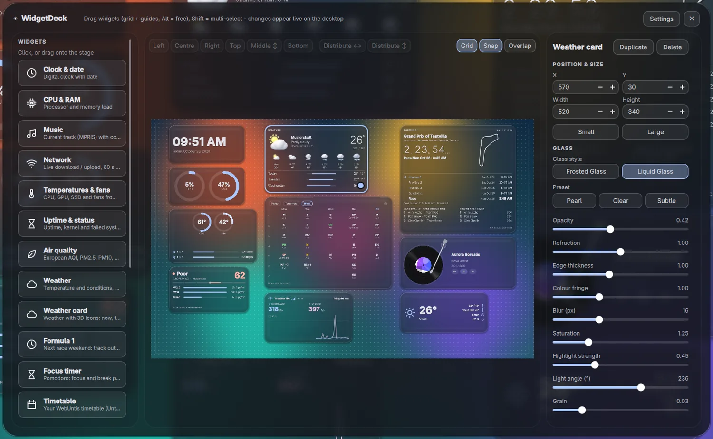
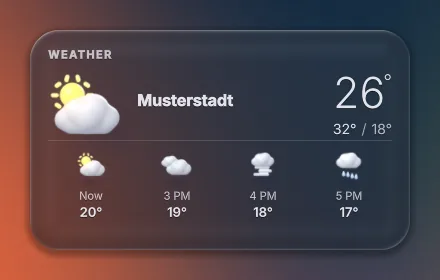
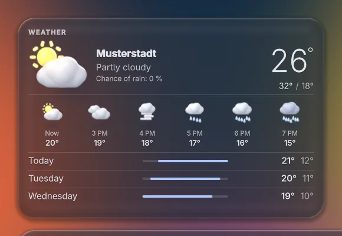
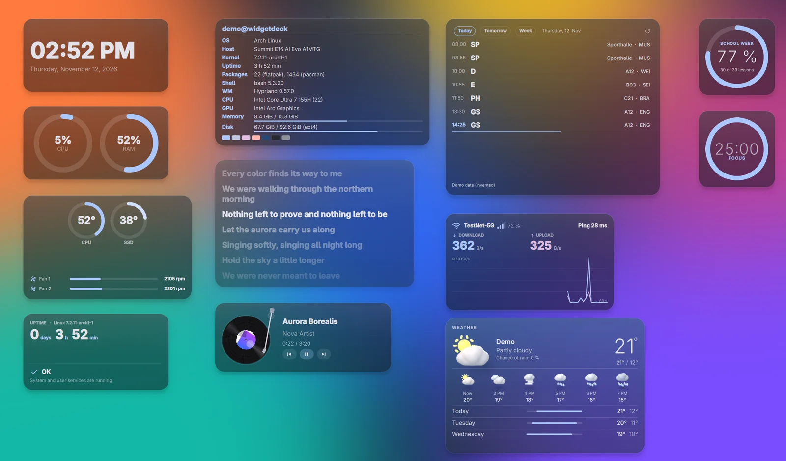
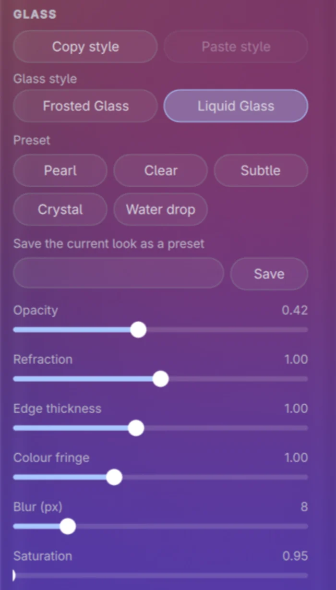
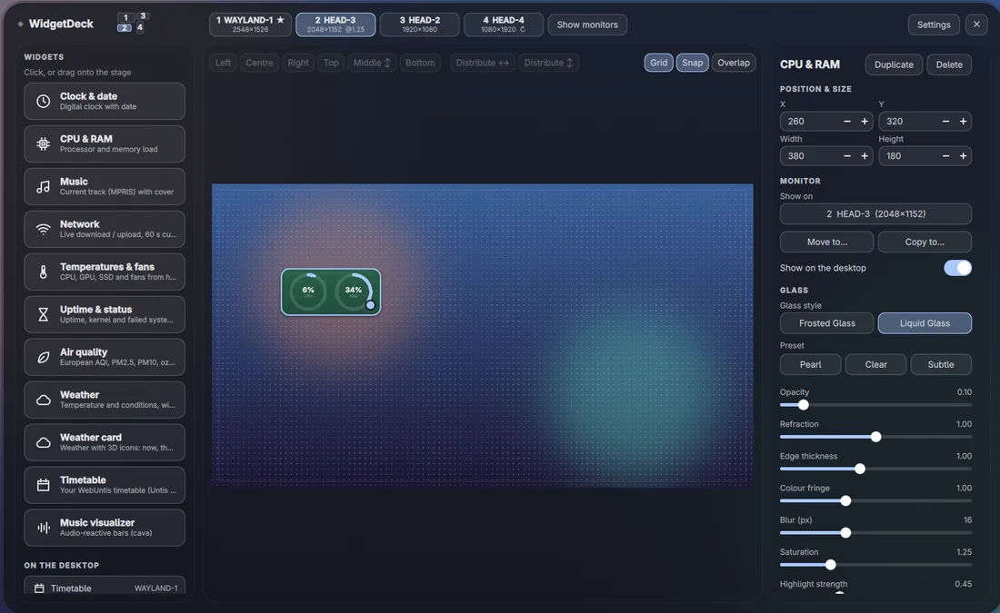

# WidgetDeck

[English version](README.en.md)

Desktop-Widgets für **Hyprland** auf **Arch Linux**, gebaut mit Quickshell: Uhr, Wetter, Musik, Systemwerte, Stundenplan, Fokus-Timer und mehr, wahlweise als **Frosted Glass** (Milchglas) oder **Liquid Glass**. Ein eingebauter Builder ordnet alles per Maus an.



> Inoffizielles Hobbyprojekt ohne Verbindung zu Formula 1, Untis, Apple oder anderen genannten Marken-Inhabern. Die Screenshots zeigen erfundene Demo-Daten.

**Version** 0.8.0 · **Lizenz** MIT · **Unterstützt** nur Arch Linux mit Hyprland und Quickshell

```bash
git clone https://github.com/Julix2009/WidgetDeck-.git
cd WidgetDeck-
./install.sh
```

## Inhalt

- [Funktionen auf einen Blick](#funktionen-auf-einen-blick)
- [Voraussetzungen](#voraussetzungen)
- [Installation](#installation)
- [Erster Start](#erster-start)
- [Bedienung](#bedienung)
- [Widgets im Detail](#widgets-im-detail)
- [Datenschutz und Sicherheit](#datenschutz-und-sicherheit)
- [Updates und Deinstallation](#updates-und-deinstallation)
- [Fehlerbehebung](#fehlerbehebung)
- [Projektstruktur](#projektstruktur)
- [Mitwirken, Lizenz und Danksagungen](#mitwirken-lizenz-und-danksagungen)

## Funktionen auf einen Blick

- **Builder** mit Raster, Hilfslinien, Mehrfachauswahl, Ausrichten und Verteilen
- **Zwei Glas-Stile:** Frosted Glass und Liquid Glass (eigener Shader, der das Wallpaper bricht), pro Widget einstellbar; Liquid Glass hat Presets und eine optionale **Kantenlinse** (der Rand biegt den Hintergrund wie ein Wassertropfen)
- **Stil kopieren und einfügen:** das Aussehen eines Widgets auf andere übertragen, auch auf mehrere gleichzeitig
- **Theming** mit Matugen: Farben folgen dem Wallpaper (optional, sonst feste Standardpalette)
- **Mehrere Monitore** mit stabiler Monitor-Kennung, eigenem Layout und Wallpaper pro Monitor
- **Größen:** Widgets mit zwei Größen wechseln per *Klein* / *Groß* animiert
- **Module:** Leiste und Benachrichtigungen mit Power-Menü sind eingebaut, aber standardmäßig **aus**
- **Sparsam:** alle Widgets laufen in einem einzigen Prozess; der Builder wird nur geladen, solange er offen ist
- **Eigenständig:** keine fremden Dotfiles, kein Icon-Theme und keine bestimmte Schrift nötig; Oberfläche auf Deutsch und Englisch

| Widget | Was es zeigt | Größen | Besonderheit, benötigt |
|---|---|---|---|
| Uhr & Datum | Digitaluhr mit Datum | Standard | – |
| CPU & RAM | Auslastung als Ringe oder Balken | Standard | – |
| Musik | aktueller Titel, Stil Normal oder Plattenspieler | Klein / Groß | MPRIS-Player; `playerctl` optional |
| Netzwerk | Down- und Upload live, 60-s-Kurve, WLAN, Ping | Standard | `iproute2`, `iputils`; `networkmanager` optional; pingt standardmäßig `1.1.1.1` |
| Temperaturen & Lüfter | CPU, GPU, SSD, Lüfter | Standard | hwmon-Sensoren; Fehlendes wird ausgelassen |
| Uptime & Status | Laufzeit, Kernel, fehlgeschlagene systemd-Dienste | Standard | systemd |
| Luftqualität | Europäischer AQI, PM2.5, PM10, Ozon | Standard | Internet (Open-Meteo) |
| Wetter | Temperatur und Wetterlage, Regen- und Schneepartikel (nur Liquid Glass) | Standard | Internet (Open-Meteo) |
| Wetter-Karte | 3D-Icons, nächste Stunden und Tage | Klein / Groß | Internet (Open-Meteo), gleiche Daten wie *Wetter* |
| Formel 1 (inoffiziell) | nächstes Rennwochenende, Ergebnis, Wertung | Klein / Groß | `python`, Internet (Jolpica-F1, OpenF1) |
| Fokus-Timer | Pomodoro-Ring mit Sessions | Klein / Groß | Befehl `focus-timer`; Ton und Meldung optional |
| Schulfortschritt | wie viel Prozent vom Schultag oder von der Schulwoche vorbei sind | Standard | Daten des Stundenplan-Widgets |
| Stundenplan | WebUntis über den Untis-Mobile-Zugang | Klein / Groß | `python`, `zbar`, `libsecret`, Secret Service |
| Musik-Visualizer | audio-reaktive Balken | Standard | `cava` |
| Songtext | synchroner Songtext des laufenden Lieds, die gesungene Zeile leuchtet auf wie bei Spotify | Standard | MPRIS-Player, Internet ([LRCLIB](https://lrclib.net)) |
| System-Info | Überblick im Stil von fastfetch: System, Kernel, Laufzeit, Pakete, CPU, GPU, RAM, Speicher, kleines Logo | Standard | `fastfetch` |

Die Pixelgrößen und alle Einstellungen stehen in [docs/widgets.md](docs/widgets.md).

## Voraussetzungen

| Komponente | Stand |
|---|---|
| System | Arch Linux (oder Ableger mit `ID_LIKE=arch`); der Installer bricht sonst ab und läuft nicht als root |
| Hyprland | getestet mit **0.55.4** (läuft nach bisherigen Erfahrungen auch unter 0.57), Konfiguration als `hyprland.conf` (hyprlang) und als Lua-Datei `hyprland.lua` (ab 0.55). Ab 0.53 gilt die Blocksyntax der Regeln (ungetestet), darunter die alte Syntax (ungetestet). Unter 0.40 bricht der Installer ab. |
| Quickshell | getestet mit **0.3.0** (Git-Build `quickshell-git`); der Installer warnt unter 0.2.0 |
| Qt | 6.7 oder neuer, getestet mit 6.11.1 |
| GPU | getestet mit Intel Arc; AMD und NVIDIA sind **ungetestet**. Liquid Glass braucht den Shader (`qsb`), ohne ihn verwenden alle Widgets Frosted Glass. |
| Wallpaper | für Liquid Glass erkannt über awww (getestet), swww, hyprpaper, swaybg, wpaperd (nur simuliert getestet) oder ein von Hand gewähltes Bild |

Alle Pakete stammen aus den **offiziellen Repositories**; es ist kein AUR-Paket nötig. Der Installer installiert nie etwas aus dem AUR.

**Pflicht:** `quickshell qt6-declarative qt6-wayland qt6-shadertools jq curl iproute2 iputils`. **Empfohlen:** `adwaita-fonts` (ohne sie nimmt WidgetDeck die nächste installierte Schrift).

| Funktion | Paket | Repository |
|---|---|---|
| WLAN-Name im Netzwerk-Widget | `networkmanager` | extra |
| Sprungrichtung im Musik-Widget | `playerctl` | extra |
| Musik-Visualizer | `cava` | extra |
| System-Info-Widget | `fastfetch` | extra |
| Farben aus dem Wallpaper | `matugen` | extra |
| Formel-1- und Stundenplan-Widget | `python` | core |
| QR-Code lesen (Stundenplan) | `zbar` | extra |
| Schlüsselbund (Stundenplan) | `libsecret`, dazu ein Secret Service wie `gnome-keyring` | core, extra |
| Meldungen (Formel-1-Erinnerung, Fokus-Timer) | `libnotify` | extra |
| Ton des Fokus-Timers | eines von `pipewire-audio`, `libpulse`, `alsa-utils` | extra |
| Landesflagge im Formel-1-Widget | `noto-fonts-emoji` | extra |

Der Installer bietet `python`, `zbar`, `libsecret`, `networkmanager`, `playerctl`, `cava`, `fastfetch` und `matugen` an; die übrigen Pakete der Tabelle installierst du selbst.

## Installation

Der kürzeste Weg:

```bash
git clone https://github.com/Julix2009/WidgetDeck-.git
cd WidgetDeck-
./install.sh
```

Der Installer prüft das System, bietet fehlende Pakete an (`sudo pacman -S --needed`, nach Rückfrage), fragt nach den Modulen, kopiert das Programm, kompiliert die Liquid-Glass-Shader und richtet die Hyprland-Regeln ein. Danach:

```bash
hyprctl reload
widgetdeck builder
```

`hyprctl reload` lädt die Regeln (Blur, Fensterregeln). Den Autostart (`exec-once`) führt Hyprland **nur beim Start** aus, `hyprctl reload` startet WidgetDeck also nicht. `widgetdeck builder` startet den Daemon sofort und öffnet den Builder; beim nächsten Login startet er von selbst.

Erst nur ansehen, was passieren würde (ändert nichts):

```bash
./install.sh --dry-run
```

### Optionen

| Option | Wirkung |
|---|---|
| `--dry-run` | zeigt nur, was passieren würde, und ändert nichts |
| `--yes`, `-y` | keine Rückfragen: Pflicht- und empfohlene Pakete werden installiert, optionale nicht, die Verweiszeile in der Hyprland-Config wird eingetragen |
| `--modules <Liste>` | `widgets,builder,bar,notifications` (Standard: `widgets,builder`) |
| `--no-hypr-config` | fasst deine Hyprland-Config nicht an und zeigt nur, was einzutragen wäre |
| `--no-packages` | überspringt die Paketprüfung |
| `--prefix <Ordner>` | Test-Installation: der Ordner ersetzt dein Home (Config, Cache, Programm, Hyprland-Dateien liegen darunter) |
| `--channel main\|stable` | Update-Kanal: `main` (Standard, neuester Stand) oder `stable` (nur getaggte Releases) |
| `--uninstall`, `--purge` | siehe [Updates und Deinstallation](#updates-und-deinstallation) |
| `--help`, `--version` | Hilfe, Version |

### Was der Installer ändert und was nicht

| Was | Wo |
|---|---|
| Programmdateien | `~/.config/quickshell/widgetdeck/` (manuell startbar mit `qs -c widgetdeck`) |
| Befehle | `~/.local/bin/`: `widgetdeck`, `widgetdeck-update`, `widgetdeck-doctor`, `widgetdeck-untis-setup`, `focus-timer` |
| Deine Einstellungen | `~/.config/widgetdeck/`; `config.json` wird nur angelegt, wenn sie fehlt, und nie überschrieben |
| Hyprland-Regeln | **eigene Datei** `~/.config/hypr/widgetdeck.conf` (bei Lua `widgetdeck.lua`) |
| Hyprland-Verweiszeile | **eine markierte Zeile** in `hyprland.conf` (bzw. `hyprland.lua`), nur nach Rückfrage, mit Backup `<Datei>.widgetdeck-backup-<Zeitstempel>` und vorheriger Prüfung per `Hyprland --verify-config` |
| Matugen | ein markierter Block in `~/.config/matugen/config.toml` samt Vorlage, nur wenn `matugen` installiert ist und du zustimmst (Backup wie oben) |
| Cache und Log | `~/.cache/widgetdeck/` |

Pfade folgen `XDG_CONFIG_HOME` und `XDG_CACHE_HOME`, falls gesetzt. Der Installer beendet, deaktiviert oder ersetzt kein anderes Programm, ändert sonst nichts an deiner Hyprland-Config und läuft nicht als root (nur `pacman` ruft er über `sudo` auf). Eine schreibgeschützte oder in den Nix-Store verlinkte Config rührt er nicht an und zeigt die Zeilen nur an.

### Optional: Paket bauen

Aus einem Klon lässt sich ein pacman-Paket bauen. `./install.sh` bleibt der empfohlene Weg.

```bash
cd packaging
makepkg -si
```

Das Paket legt die Dateien nach `/usr/share/widgetdeck/` und die Befehle `widgetdeck`, `widgetdeck-doctor`, `widgetdeck-untis-setup` und `focus-timer` nach `/usr/bin/`. Es richtet **keine** Hyprland-Regeln ein (die Vorlagen liegen in `/usr/share/widgetdeck/hypr/`, der Platzhalter `@BIN@` steht für `/usr/bin/widgetdeck`) und enthält kein `widgetdeck-update`. Die `PKGBUILD` ist nicht im AUR.

## Erster Start

Beim ersten Start öffnet sich einmalig ein Einrichtungsassistent. Er lässt sich überspringen und später mit `widgetdeck wizard` oder im Builder unter *Einstellungen → Einrichtungsassistent erneut starten* wiederholen.

1. **Wallpaper:** WidgetDeck sucht es bei awww, swww, hyprpaper, swaybg und wpaperd. Findet es nichts, wählst du ein Bild; ohne Wallpaper ist Liquid Glass aus.
2. **Standort** für Wetter und Luftqualität: *Automatisch* (deine IP-Adresse geht einmal pro Woche an ipwho.is, siehe [Datenschutz](#datenschutz-und-sicherheit)), *Selbst eintragen* (Koordinaten, nichts wird nachgeschlagen) oder *Kein Wetter*.
3. **Einheiten und Sprache:** °C/°F, 24 h/12 h, Deutsch oder Englisch (Standard: wie das System).
4. **Stil:** *Standard (Frosted)* oder *Liquid Glass*, dazu die Größe der Widgets (Klein, Mittel, Groß).
5. **Widgets** auswählen. Für den Stundenplan gibt es hier den Knopf *Einrichten …* (siehe [Stundenplan](#widgets-im-detail)).

## Bedienung



`widgetdeck toggle` öffnet und schließt den Builder (Bearbeiten-Modus). Auf dem Desktop selbst nehmen die Widgets keine Klicks an.

| Aktion | So geht's |
|---|---|
| Widget hinzufügen | links anklicken oder auf die Fläche ziehen |
| Verschieben | ziehen; Raster und Hilfslinien rasten ein, mit `Alt` frei, mit `Shift` Mehrfachauswahl |
| Pfeiltasten | eine Rasterzelle, mit `Shift` fünf; `Entf` löscht die Auswahl, `Esc` schließt |
| Ausrichten, Verteilen | Leiste oben: Links, Mitte, Rechts, Oben, Mitte ↕, Unten, Verteilen ↔ und ↕ (bricht bei schmalem Fenster in eine zweite Zeile um) |
| Raster | Schalter *Raster*, *Einrasten*, *Überlappen* oben rechts; Rastergröße und Randabstand unter *Einstellungen* |
| Größe | Breite und Höhe im Panel rechts; *Klein* / *Groß* wechselt animiert (nur Widgets mit zwei Größen) |
| Kopie, Löschen | Knöpfe oben im Panel rechts |
| Stil übertragen | *Stil kopieren* / *Stil einfügen* im Bereich *Glas* oder `Strg+Umschalt+C` / `V` (auch `Strg+C` / `V`, solange kein Textfeld den Fokus hat); beim Einfügen auf mehrere markierte Widgets gilt der Stil für alle |
| Module | *Einstellungen → Module* oder `widgetdeck module bar on` (`widgets`, `builder`, `bar`, `notifications`) |

 

### Glas-Stile

| | Frosted Glass (Milchglas) | Liquid Glass |
|---|---|---|
| Wirkung | Hintergrund-Blur von Hyprland | eigener Shader, der das Wallpaper bricht |
| Braucht | Blur in Hyprland (Standard) und die Regeldatei | `qsb` (`qt6-shadertools`) und ein erkanntes Wallpaper |
| Fehlt es | – | alle Widgets fallen auf Frosted Glass zurück |
| Einstellungen | Tönung, Rand, Deckkraft, Glanz | Presets *Perle*, *Klar*, *Dezent*, *Kristall*, *Wassertropfen* (dazu eigene Presets) und Regler für Deckkraft, Brechungsstärke, Rand-Dicke, Farbsaum, Blur, Sättigung, Highlight, Lichtwinkel, Körnung; dazu die *Kantenlinse* |



Den Stil und die Regler stellst du pro Widget im Panel rechts unter *Glas-Stil* ein (Liquid Glass bearbeiten: Preset wählen, dann Regler anpassen). Die Preset-Knöpfe brechen bei Bedarf in mehrere Zeilen um:



**Eigene Presets:** *Aktuellen Look als Preset speichern* sichert alle Liquid-Glass-Werte des Widgets unter einem Namen (Eckenradius und Verschmelzung gehören zum Widget und bleiben draußen). Die Presets erscheinen unter *Eigene Presets*, ein Klick wendet sie an, das kleine ✕ löscht sie. Sie stehen in `config.json` unter `user_presets`.

**Kantenlinse (Liquid Glass):** Der Bereich *Kantenlinse* mit dem Regler *Linsenstärke* ist zunächst aus (0): dann sieht jedes Widget aus wie vorher. Mit Stärke über 0 biegt der Rand den Hintergrund nach innen und spaltet ihn in einen feinen Regenbogensaum, dazu kommen ein heller Rand oben und ein weicher Schatten unten. *Kantenbiegung*, *Regenbogensaum* und *Linsen-Tönung* erscheinen erst, wenn die Linse an ist. *Kristall* ist klares Glas mit hellem Rand, *Wassertropfen* ein Tropfen mit weichem Leuchten statt weißer Umrandung. Je kleiner die *Linsen-Tönung*, desto durchsichtiger das Glas.

### Mehrere Monitore



WidgetDeck erkennt Monitore selbst und merkt sie sich über eine stabile Kennung (Hersteller, Modell, Seriennummer, sonst die Beschreibung; der Anschlussname allein ist nie die Identität). Mit mehreren Monitoren zeigt der Builder oben eine Monitor-Leiste und den Knopf *Monitore anzeigen*. Im Panel steht pro Widget *Anzeigen auf* (ein Monitor, *Hauptmonitor* oder *Alle Monitore*), *Verschieben nach …*, *Kopieren nach …* und der Schalter *Auf dem Desktop anzeigen*, mit dem du ein Widget aus- und einblendest. Widgets eines abgezogenen Monitors werden nicht gelöscht: Sie warten (Standard) oder wandern auf den Hauptmonitor und kehren zurück. Daten werden nur einmal abgefragt, nicht pro Monitor.

### Befehle

| Befehl | Wirkung |
|---|---|
| `widgetdeck daemon` | startet die Widgets im Vordergrund (für den Autostart) |
| `widgetdeck builder`, `toggle`, `close` | Builder öffnen (startet den Daemon bei Bedarf), umschalten, schließen |
| `widgetdeck stop`, `restart`, `log` | beenden, neu starten, Shell-Protokoll |
| `widgetdeck status` | Exit-Code 0, wenn der Daemon läuft |
| `widgetdeck wizard` | Einrichtungsassistent erneut zeigen |
| `widgetdeck module <Name> on\|off` | Modul schalten |
| `widgetdeck config` | Pfad der `widgets.json` ausgeben |
| `widgetdeck ipc <Funktion> [Argumente]` | roher IPC-Aufruf, zum Beispiel `ping`, `list`, `powerPanel`, `toggleDnd`, `dismissNotifications`, `reloadWallpaper`; alle Funktionen stehen in `qml/shell.qml` |
| `widgetdeck-doctor` | prüft das Setup (auch `widgetdeck doctor`) |
| `widgetdeck-update` | aktualisiert, siehe [Updates](#updates-und-deinstallation) |
| `widgetdeck-untis-setup` | verbindet das Stundenplan-Widget (`--remove` löscht den Zugang) |
| `focus-timer toggle\|start\|pause\|reset\|skip\|status [--json]` | steuert den Fokus-Timer, zum Beispiel per Tastenkürzel |

### Beispiel-Tastenkürzel

Die Regeldatei enthält diese Zeilen auskommentiert (`widgetdeck.conf` mit `bind = …`, `widgetdeck.lua` mit `hl.bind(…)`).

`hyprland.conf`:

```ini
bind = SUPER, W, exec, widgetdeck toggle
bind = SUPER SHIFT, P, exec, widgetdeck ipc powerPanel
bind = SUPER, N, exec, widgetdeck ipc toggleDnd
bind = SUPER, F, exec, focus-timer toggle
bind = SUPER SHIFT, F, exec, focus-timer skip
```

`hyprland.lua` (Hyprland ab 0.55):

```lua
hl.bind("SUPER + W", hl.dsp.exec_cmd("widgetdeck toggle"))
hl.bind("SUPER + SHIFT + P", hl.dsp.exec_cmd("widgetdeck ipc powerPanel"))
hl.bind("SUPER + N", hl.dsp.exec_cmd("widgetdeck ipc toggleDnd"))
hl.bind("SUPER + F", hl.dsp.exec_cmd("focus-timer toggle"))
hl.bind("SUPER + SHIFT + F", hl.dsp.exec_cmd("focus-timer skip"))
```

`powerPanel` braucht das Leisten- oder das Benachrichtigungsmodul, `toggleDnd` das Benachrichtigungsmodul. Steht `~/.local/bin` nicht im `PATH` von Hyprland, schreibe den vollen Pfad (`$HOME/.local/bin/focus-timer`).

## Widgets im Detail

Alle Einstellungen, Schlüssel und Standardwerte stehen in [docs/widgets.md](docs/widgets.md). Hier das Wichtigste.

<details>
<summary>Uhr, CPU & RAM, Temperaturen, Uptime</summary>

- **Zweck:** Systemwerte auf einen Blick. Die Daten kommen lokal (`/proc`, `/sys/class/hwmon`, systemd); kein Netzwerkzugriff.
- **Einstellungen:** Formate, Darstellung als Ringe oder Balken, Warnschwelle der Temperatur.
- **Besonderheit:** Fehlende Sensoren oder Lüfter werden ausgelassen.

</details>

<details>
<summary>Netzwerk</summary>

- **Zweck:** Down- und Upload, 60-s-Kurve, WLAN-Name und -Signal, Ping; alle Farben (Download, Upload, WLAN, Ping, Fehler) sind einstellbar, als Theme-Rolle oder eigene Farbe.
- **Datenquelle:** `ip`, `ping` alle 3 s, `nmcli` alle 5 s (optional).
- **Einstellung:** das Ping-Ziel (Standard `1.1.1.1`).

</details>

<details>
<summary>Wetter, Wetter-Karte, Luftqualität</summary>

- **Datenquelle:** Open-Meteo, ohne Schlüssel; gesendet werden nur Koordinaten. Wetter und Wetter-Karte teilen eine Abfrage pro 10 Minuten, die Luftqualität fragt alle 30 Minuten.
- **Wetter-Karte:** 3D-Icons (16 Icon-Sets, eigene Blender-Renderings, im Repository enthalten), große Größe mit 4 bis 8 Stunden und 3 bis 7 Tagen.
- **Besonderheit:** Offline bleiben die letzten Werte mit „As of HH:MM“ stehen.

</details>

<details>
<summary>Musik, Musik-Visualizer</summary>

- **Musik:** zeigt den Titel eines beliebigen MPRIS-Players; Stil *Normal* oder *Plattenspieler* (Drehzahl, Tonarm folgt dem Fortschritt, Vinylfarbe).
- **Visualizer:** Balken über `cava` und PipeWire, ein `cava` für alle Visualizer mit gleichen Einstellungen.

</details>

<details>
<summary>Fokus-Timer</summary>

- **Zweck:** Pomodoro mit Fokus (25 min), kurzer (5 min) und langer Pause (15 min nach 4 Sessions); alle Längen einstellbar.
- **Ein Timer für alle:** Er lebt mit der Shell, Ausblenden oder Monitor-Wechsel halten ihn nicht an.
- **Steuerung:** `focus-timer …`, siehe [Befehle](#befehle).
- **Optional:** „Nicht stören“ während des Fokus (WidgetDeck, dunst, mako, swaync), Ton und Meldung am Phasenende.
- **Daten:** Statistik in `~/.config/widgetdeck/focus-stats.json`, laufender Zustand in `focus-state.json`; beides bleibt lokal.

</details>

<details>
<summary>Schulfortschritt</summary>

- **Zweck:** zeigt als Ring, wie viel vom Schultag oder von der Schulwoche vorbei ist, gezählt in Stunden des Stundenplans.
- **Daten:** nutzt die Daten des Stundenplan-Widgets; ohne Stundenplan gibt es nichts zu zählen.

</details>

<details>
<summary>Songtext</summary>

- **Zweck:** zeigt nur den Text des laufenden Lieds, synchron zur Wiedergabe: Die Zeile, die gerade gesungen wird, ist hell, die anderen sind gedimmt, und der Text scrollt mit. Instrumentale Pausen erscheinen als ♪.
- **Datenquelle:** [LRCLIB](https://lrclib.net) (frei, ohne Schlüssel). Pro Lied geht eine Anfrage hin (Interpret, Titel, Album, Länge und wie bei jeder Verbindung deine IP-Adresse); gefundene Texte werden 30 Tage lokal in `~/.cache/widgetdeck/lyrics/` gespeichert. Die Position kommt vom MPRIS-Player.
- **Einstellungen:** Textgröße, Ausrichtung, aktuelle Zeile in der Akzentfarbe, Titel und Interpret, Player. Gibt es für ein Lied keinen synchronisierten Text, sagt das Widget es.
- **Hinweis:** Die Songtexte gehören den Rechteinhabern; WidgetDeck zeigt sie nur auf deinem Rechner an und liefert keine mit.

</details>

<details>
<summary>System-Info (fastfetch)</summary>

- **Zweck:** Überblick im Stil von `fastfetch`: System, Kernel, Laufzeit, Pakete, CPU, GPU, RAM, Speicher, dazu kleines Logo und Farbblöcke.
- **Datenquelle:** `fastfetch --json`, lokal, etwa einmal pro Minute bei sichtbarem Widget; ohne `fastfetch` zeigt das Widget einen Hinweis.

</details>

<details>
<summary>Stundenplan (WebUntis, Untis-Mobile-Zugang)</summary>

Das Widget zeigt deinen eigenen Stundenplan über den Untis-Mobile-Zugang deines Kontos, oft die einzige Möglichkeit, weil der normale Login hinter einem Microsoft-Login liegt.

**Einrichtung:**

1. `python`, `zbar`, `libsecret` und einen Secret Service (gnome-keyring, KeePassXC mit Secret Service oder KWallet) installieren.
2. In WebUntis *Profil → Freigaben → Untis Mobile → Anzeigen* öffnen und den QR-Code **lokal** als Bild speichern.
3. `widgetdeck-untis-setup` ausführen und den Pfad des Bilds angeben. Das Skript liest den QR-Code, prüft den Zugang mit einem Login und legt den Schlüssel im Schlüsselbund ab.
4. Das Bild und alle anderen Kopien löschen: Wer das Bild hat, kann deinen Stundenplan lesen.
5. Das Widget *Stundenplan* im Builder hinzufügen.

**Datenquelle:** der Server deiner Schule über die Schnittstelle der Untis-Mobile-App, alle 15 Minuten bei sichtbarem Widget. Es werden nur dein Stundenplan und das Zeitraster gelesen, keine Noten, Abwesenheiten, Hausaufgaben oder Nachrichten.

**Hinweise:** Die Schnittstelle ist nicht offiziell dokumentiert, und eine Schule kann sie abschalten; veröffentlichte Limits sind nicht bekannt, WidgetDeck drosselt selbst. Läuft der Zugang ab, zeigt das Widget einen Hinweis; dann `widgetdeck-untis-setup` erneut ausführen. Mehr in [docs/widgets.md](docs/widgets.md#stundenplan-webuntis--untis-mobile).

</details>

<details>
<summary>Formel 1 (inoffiziell)</summary>

Zeigt das nächste Rennwochenende mit Streckenumriss, Countdown, allen Sessions in Ortszeit, letztem Ergebnis und Fahrerwertung. **Inoffiziell:** keine Verbindung zu Formula 1, FIA, Teams oder Fahrern; es werden keine Logos oder Bilder geladen und nichts von Webseiten gelesen.

**Einrichtung:** keine, Widget hinzufügen (`python` nötig).

**Datenquellen:** [Jolpica-F1](https://github.com/jolpica/jolpica-f1) (Kalender höchstens einmal pro Tag, Ergebnisse und Wertung alle 6 Stunden) und [OpenF1](https://openf1.org) (abgesagte Rennen, optional Live-Ansicht, standardmäßig aus). Alles holt ein gemeinsamer Feed mit Zwischenspeicher; nach Fehlern wartet er 5 Minuten, verdoppelt bis höchstens 2 Stunden, und befolgt HTTP 429 und `Retry-After`.

**Lizenzen:** Die Jolpica-Daten stehen unter CC BY-NC-SA 4.0 (nur nicht-kommerzielle Nutzung, Namensnennung). Die Streckenumrisse stammen vereinfacht aus bacinger/f1-circuits (MIT). Details in [NOTICE.md](NOTICE.md) und [docs/widgets.md](docs/widgets.md#formel-1-inoffiziell).

</details>

## Datenschutz und Sicherheit

**Lokal** bleiben deine Einstellungen und das Layout (`~/.config/widgetdeck/`), die Fokus-Statistik und die Zwischenspeicher (`~/.cache/widgetdeck/`: Wetter, Standort, Formel 1, Stundenplan mit Rechten 600). Den Untis-Schlüssel legt `widgetdeck-untis-setup` im Schlüsselbund (Secret Service) ab; nur auf deinen Wunsch landet er stattdessen in einer privaten Datei (`~/.local/share/widgetdeck-private/untis.json`, Rechte 600). Im Code gibt es keine weiteren Netzwerkziele als die folgenden; Telemetrie gibt es nicht.

| Ziel | Wann | Was geht hin | Abschalten |
|---|---|---|---|
| Open-Meteo (`api.open-meteo.com`, `air-quality-api.open-meteo.com`) | solange Wetter, Wetter-Karte oder Luftqualität sichtbar sind | Koordinaten; die IP-Adresse sieht der Server wie bei jeder Verbindung | die Widgets entfernen; im Assistenten *Kein Wetter* |
| LRCLIB (`lrclib.net`) | nur mit Songtext-Widget, einmal pro Lied (danach aus dem lokalen Zwischenspeicher) | Interpret, Titel, Album und Länge des Lieds; die IP-Adresse sieht der Server wie bei jeder Verbindung | Widget entfernen |
| ipwho.is | nur bei Standort *Automatisch*, nach dem Assistenten, höchstens einmal pro Woche (Ergebnis wird gespeichert) | deine IP-Adresse; zurück kommt der Ort auf Stadtebene | Koordinaten selbst eintragen oder `"location": {"auto": false}` in `config.json` |
| Jolpica-F1, OpenF1 | nur mit Formel-1-Widget | die Anfrage nach Kalender und Ergebnissen; keine persönlichen Daten außer der IP | Widget entfernen; Live-Daten sind standardmäßig aus |
| Server deiner Schule (WebUntis) | nur mit Stundenplan-Widget, alle 15 Minuten | deine Untis-Benutzerkennung und ein aus dem Schlüssel berechneter Einmalcode (der Schlüssel selbst nie), per HTTPS mit Zertifikatsprüfung | `widgetdeck-untis-setup --remove`, Widget entfernen |
| Ping-Ziel (Netzwerk-Widget) | alle 3 Sekunden | ICMP-Echo an `1.1.1.1` (änderbar) | Ziel ändern oder Widget entfernen |
| GitHub (Update-Prüfung) | höchstens einmal pro Tag, `git ls-remote` ohne Token | Git-Anfrage an dieses Repository | *Einstellungen → Täglich nach Updates suchen* aus, oder `"update": {"check": false}` |

Sicherheit: Der Installer läuft nicht als root und nutzt `sudo` nur für `pacman`. Die Hyprland-Config wird vor jeder Änderung gesichert und per `Hyprland --verify-config` geprüft. `widgetdeck-update` installiert nie automatisch; es zeigt die Änderungen und fragt.

## Updates und Deinstallation

```bash
widgetdeck-update              # zeigt die Änderungen, fragt, aktualisiert; Einstellungen bleiben unberührt
widgetdeck-update --rollback   # zurück auf die Version vor dem letzten Update
./uninstall.sh                 # entfernt, was installiert wurde; fragt vor dem Löschen deiner Einstellungen
```

| Option von `widgetdeck-update` | Wirkung |
|---|---|
| `--yes`, `-y` | keine Rückfragen (lokale Änderungen werden vorher gesichert) |
| `--dry-run` | zeigt nur, was passieren würde |
| `--channel main\|stable` | neuester Stand oder nur getaggte Releases (wird gemerkt) |
| `--version vX.Y.Z` | eine bestimmte Version installieren |
| `--rollback` | zurück auf die vorherige Version, mit dem Backup der Einstellungen |
| `--no-packages`, `--no-restart` | Paketprüfung bzw. Neustart der Widgets überspringen |

`widgetdeck-update` arbeitet im geklonten Ordner: Es holt den Remote-Stand, zeigt den Auszug aus dem Änderungsprotokoll seit deiner Version, ersetzt die Programmdateien, kompiliert die Shader neu und startet die Widgets neu. Fehlt der Klon, klont es das Repository neu. Im Builder zeigt *Einstellungen → Version & Updates* einen Hinweis, wenn es eine neuere Version gibt.

- **Einstellungen bleiben:** Ein Update ersetzt nur Programmdateien. Ändert sich das Format, laufen nummerierte Migrationen (`migrations/`) der Reihe nach; vorher entsteht ein Backup `~/.config/widgetdeck.bak-<Datum>` (die fünf neuesten bleiben). Schlägt eine Migration fehl, werden die Einstellungen zurückgespielt und das Update bricht ab.
- **Lokale Änderungen** im Klon: Das Skript bietet `git stash` oder eine Kopie mit Zeitstempel an. Von Hand bearbeitete installierte Dateien landen vor dem Ersetzen in `~/.cache/widgetdeck/program-backup-<Datum>`.
- **Deinstallation:** `./uninstall.sh` stoppt den Daemon, entfernt Programm, Befehle, Matugen-Block und Vorlage und die Hyprland-Verweiszeile (aus dem Backup, wenn du die Datei seitdem nicht geändert hast, sonst nur die markierte Zeile). Die Regeldatei wird nur gelöscht, wenn du sie nicht geändert hast. Deine Einstellungen löscht sie nur auf Nachfrage; `./uninstall.sh --purge` löscht Einstellungen und Cache ohne Nachfrage.

## Fehlerbehebung

Zuerst `widgetdeck-doctor` ausführen: Es nennt zu jeder WARN- und FAIL-Zeile eine Lösung.

| Symptom | Lösung |
|---|---|
| Nichts erscheint | `widgetdeck status`; `widgetdeck builder` startet den Daemon sofort (`hyprctl reload` startet ihn nicht) |
| Liquid Glass wirkt flach | `sudo pacman -S qt6-shadertools`, dann `widgetdeck restart`; `widgetdeck-doctor` zeigt Shader- und Wallpaper-Zeilen |
| Wallpaper nicht erkannt | *Einstellungen → Glas-Hintergrund*: Bild wählen |
| Falscher Wetterort | *Einstellungen → Standort*: Koordinaten eintragen |
| Widgets auf dem falschen Monitor | im Panel *Anzeigen auf* oder *Verschieben nach …* |
| Builder öffnet sich nicht beim Login | gewollt: er wird nur geladen, solange er offen ist; `widgetdeck builder` oder `widgetdeck toggle` öffnet ihn |

Alle bekannten Probleme (Benachrichtigungsdienst-Konflikt, Stundenplan-Zugang abgelaufen, Tastenkürzel ohne Wirkung …) stehen in [docs/troubleshooting.md](docs/troubleshooting.md). Für ein Issue die Ausgabe von `widgetdeck-doctor --plain` komplett ins [Bug-Report-Formular](https://github.com/Julix2009/WidgetDeck-/issues) einfügen; das Programm ersetzt dein Home-Verzeichnis durch `~` und gibt weder Standort noch Wallpaper-Pfad aus.

## Projektstruktur

| Ordner, Datei | Inhalt |
|---|---|
| `qml/` | das Programm: `shell.qml`, `core/` (Glas, Store, Monitore, Theme), `widgets/`, `builder/`, `wizard/`, `modules/` (Leiste, Benachrichtigungen, Power-Menü) |
| `bin/` | die Befehle `widgetdeck`, `widgetdeck-update`, `widgetdeck-doctor`, `widgetdeck-untis-setup`, `focus-timer` |
| `lib/` | gemeinsame Skript-Bausteine von Installer und Updater (Pakete, Hyprland, Migrationen, Texte) |
| `hypr/` | Vorlagen der Hyprland-Regeln (hyprlang, alte Syntax, Lua) |
| `migrations/` | nummerierte Migrationen der Einstellungen |
| `matugen/` | Vorlage für die Farbpalette |
| `packaging/` | `PKGBUILD` für den optionalen Paket-Weg |
| `examples/` | Beispiel für ein eigenes Widget |
| `tools/` | Tests, Test-Sitzung (`tools/nested`), Messwerkzeuge, Blender-Skripte, Formel-1-Werkzeuge |
| `docs/` | ausführliche Dokumentation und Bilder |
| `install.sh`, `update.sh`, `uninstall.sh` | Installer, Updater, Deinstallation |
| `LICENSE`, `NOTICE.md`, `LICENSES/` | Lizenz und Herkunft fremder Teile |

**Neues Widget hinzufügen:** ein eigenes Widget brauchst du nur in `~/.config/widgetdeck/widgets/` abzulegen, ein eingebautes ist ein Eintrag in `qml/widgets/Registry.js`. Die Anleitung steht in [docs/neues-widget.md](docs/neues-widget.md).

## Mitwirken, Lizenz und Danksagungen

**Mitwirken:** Fehlerberichte und kleine Korrekturen sind am hilfreichsten. Die Regeln und die Prüfbefehle stehen in [CONTRIBUTING.md](CONTRIBUTING.md) (englisch), Hilfe in [SUPPORT.md](SUPPORT.md). Es gibt keine garantierte Antwortzeit.

**Lizenz:** Der eigene Code steht unter der MIT-Lizenz, siehe [LICENSE](LICENSE). Herkunft und Lizenzen fremder Teile stehen in [NOTICE.md](NOTICE.md), die Volltexte in `LICENSES/`.

| Quelle | Verwendung | Lizenz |
|---|---|---|
| [MacShell](https://github.com/0-ss/MacShell) | Vorlage des Liquid-Glass-Shaders (`glass.frag`) | MIT, © 2026 Rickky |
| [bacinger/f1-circuits](https://github.com/bacinger/f1-circuits) | Streckenumrisse (vereinfacht) | MIT, © 2019-2025 Tomislav Bacinger |
| [Open-Meteo](https://open-meteo.com) | Wetter und Luftqualität | Daten CC BY 4.0, die freie API ist für nicht-kommerzielle Nutzung gedacht |
| [Jolpica-F1](https://github.com/jolpica/jolpica-f1) | Rennkalender, Ergebnisse, Wertung | CC BY-NC-SA 4.0 (nur nicht-kommerziell) |
| [OpenF1](https://openf1.org) | abgesagte Rennen, optionale Live-Ansicht | inoffizielles Projekt, Lizenz laut `NOTICE.md` CC BY-NC-SA 4.0 |
| [LRCLIB](https://lrclib.net) | Songtexte (synchronisiert) | freier Dienst; die Texte gehören den Rechteinhabern, es wird nichts mitgeliefert |
| ipwho.is | Standort per IP | Dienst ohne Lizenzangabe im Projekt |

Nicht mitgeliefert: Schriften (bevorzugt Adwaita Sans aus `adwaita-fonts`, OFL 1.1 laut `NOTICE.md`), Emoji-Daten, Blender (nur zum Neuerzeugen der Wetter-Icons nötig). Eigene Arbeit sind die Icons (`qml/core/Icons.js`), die 3D-Wetter-Icons und der Ton des Fokus-Timers.

**Marken:** „Formula 1“, „F1“, „FIA“ und verwandte Marken gehören ihren Inhabern, ebenso „Untis“ und „WebUntis“. „Liquid Glass“ bezeichnet auch ein Design von Apple. WidgetDeck steht mit keinem dieser Inhaber in Verbindung und enthält keine ihrer Logos oder Bilder.
