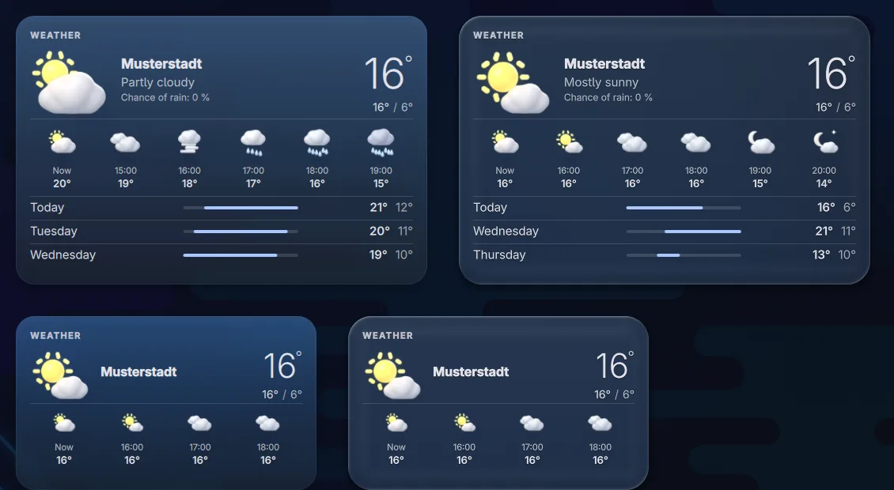
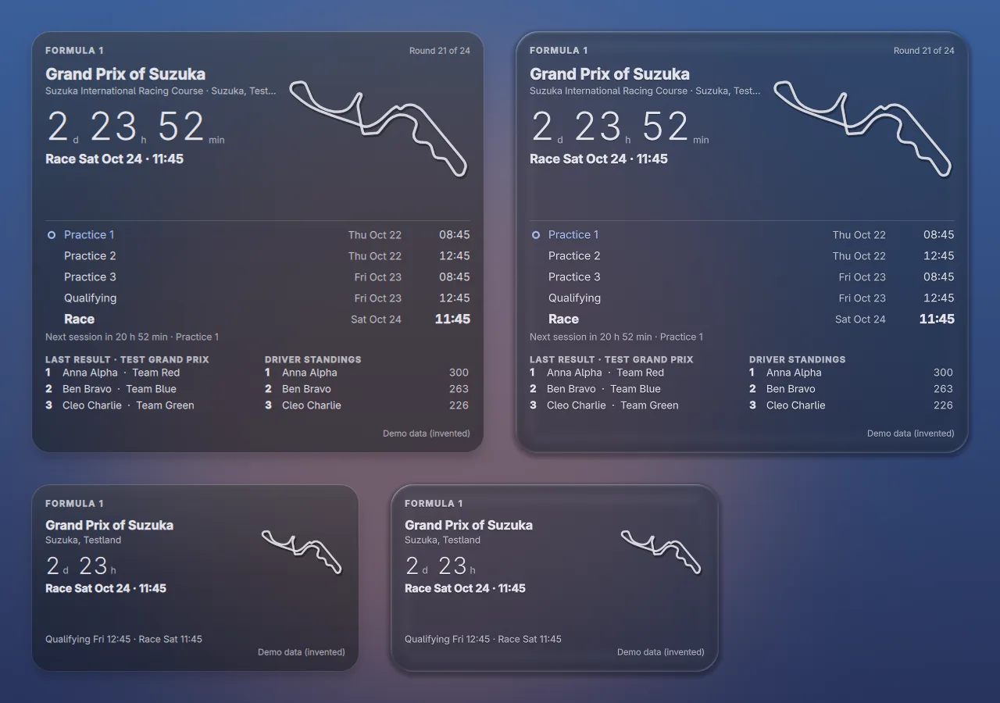
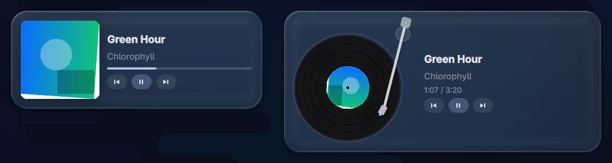
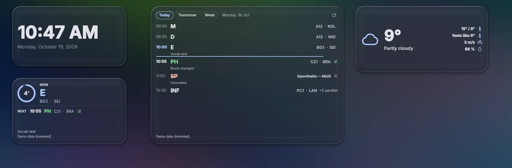
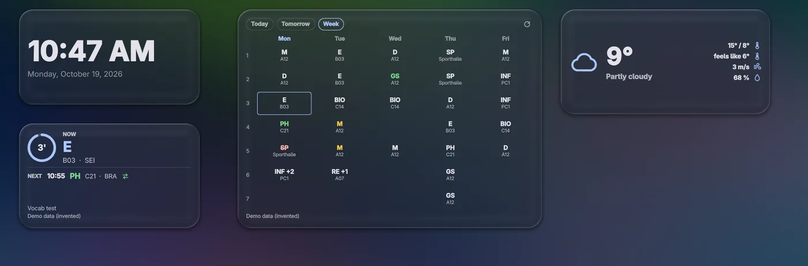

# Widgets im Detail

[Zurück zur README](../README.md) · [English README](../README.en.md)

Alle Widgets liegen auf demselben Glas-Panel. Frosted Glass (Milchglas) und Liquid Glass gelten also für jedes Widget gleich, Raster, Einrasten und mehrere Monitore ebenso. Die Einstellungen eines Widgets stehen im Builder rechts im Eigenschaften-Panel. Die Spalte „Schlüssel“ ist der Name, den `widgetdeck ipc setProp <id> <schlüssel> <json>` erwartet.

Widgets mit zwei Größen haben im Builder die Knöpfe *Klein* und *Groß*. Das Aussehen eines Widgets (Glas-Stil, Regler, Farben) lässt sich mit *Stil kopieren* und *Stil einfügen* auf andere übertragen. Bei Liquid Glass gibt es außerdem die optionale *Kantenlinse* (*Linsenstärke*, *Kantenbiegung*, *Regenbogensaum*, *Linsen-Tönung*) und die Presets *Kristall* und *Wassertropfen*; bei Linsenstärke 0 bleibt alles wie zuvor. Alle anderen haben eine Standardgröße, die du über Breite und Höhe frei ändern kannst.

Inhalt: [Uhr](#uhr--datum) · [CPU & RAM](#cpu--ram) · [Netzwerk](#netzwerk) · [Temperaturen](#temperaturen--lüfter) · [Uptime](#uptime--status) · [Luftqualität](#luftqualität) · [Wetter](#wetter) · [Wetter-Karte](#wetter-karte) · [Formel 1](#formel-1-inoffiziell) · [Fokus-Timer](#fokus-timer) · [Musik](#musik) · [Stundenplan](#stundenplan-webuntis--untis-mobile) · [Schulfortschritt](#schulfortschritt) · [System-Info](#system-info-fastfetch) · [Visualizer](#musik-visualizer)

## Uhr & Datum

*Digitaluhr mit Datum.* Größe: Standard 380×190 (logische Pixel, Breite × Höhe).

Ein leeres Zeit- oder Datumsformat bedeutet „automatisch“. Das Widget braucht keine Zusatzpakete und keinen Netzwerkzugriff.

Alle Einstellungen

| Einstellung | Schlüssel | Standard | Werte |
|---|---|---|---|
| Zeitformat (leer = automatisch) | `time_format` | leer | Text |
| Datumsformat (leer = automatisch) | `date_format` | leer | Text |
| Datum anzeigen | `show_date` | an | an / aus |
| Größe der Uhrzeit | `time_scale` | 3.6 | 1.5 – 7 |
| Ausrichtung | `align` | Links | Links / Mitte / Rechts |

## CPU & RAM

*Auslastung von Prozessor und Arbeitsspeicher.* Größe: Standard 380×190 (logische Pixel, Breite × Höhe).

Zeigt Auslastung von Prozessor und Arbeitsspeicher als Ringe oder Balken. Keine Netzwerkzugriffe, keine Zusatzpakete.

Alle Einstellungen

| Einstellung | Schlüssel | Standard | Werte |
|---|---|---|---|
| Darstellung | `mode` | Ringe | Ringe / Balken |
| CPU anzeigen | `show_cpu` | an | an / aus |
| RAM anzeigen | `show_ram` | an | an / aus |
| Aktualisierung (ms) | `interval` | 1000 | 250 – 5000 |

## Netzwerk

*Download / Upload live, 60-s-Kurve, WLAN, Signal, Ping.* Größe: Standard 440×250 (logische Pixel, Breite × Höhe).

Download und Upload live mit einer Kurve der letzten 60 Sekunden, WLAN-Name und Signal sowie die Ping-Zeit.

* **Datenquellen:** `ip` (iproute2) für die Raten, `ping` (iputils) alle 3 Sekunden zum Ping-Ziel, `nmcli` (NetworkManager, optional) alle 5 Sekunden für WLAN-Name und Signal.
* **Netzwerkzugriff:** Das Widget schickt standardmäßig ein ICMP-Echo an `1.1.1.1`. Das Ziel ist in den Einstellungen änderbar, zum Beispiel auf deinen Router.
* Ohne NetworkManager zeigt das Widget „Wi-Fi“ ohne Namen.

Alle Einstellungen

| Einstellung | Schlüssel | Standard | Werte |
|---|---|---|---|
| Ping-Ziel | `ping_target` | 1.1.1.1 | Text |
| Kurve der letzten 60 s | `show_curve` | an | an / aus |

## Temperaturen & Lüfter

*CPU, GPU, SSD und Lüfter aus hwmon.* Größe: Standard 440×270 (logische Pixel, Breite × Höhe).

Liest Sensoren aus `/sys/class/hwmon`: CPU (`coretemp`, `k10temp`), GPU (`amdgpu`, `i915`, `xe`, `nouveau`, sonst `nvidia-smi`), SSD und Lüfter. Fehlende Sensoren werden ausgelassen, das Widget braucht keine Zusatzpakete.

Alle Einstellungen

| Einstellung | Schlüssel | Standard | Werte |
|---|---|---|---|
| Darstellung | `mode` | Ringe | Ringe / Balken |
| Warnschwelle (°C) | `warn_c` | 80 | 30 – 110 |
| Lüfter anzeigen | `show_fans` | an | an / aus |

## Uptime & Status

*Laufzeit, Kernel und fehlgeschlagene systemd-Dienste.* Größe: Standard 380×200 (logische Pixel, Breite × Höhe).

Zeigt Laufzeit, Kernel-Version und die Anzahl fehlgeschlagener systemd-Dienste (System- und Benutzerdienste). Braucht systemd. Das Widget liest nur lokale Systemdaten.

Alle Einstellungen

| Einstellung | Schlüssel | Standard | Werte |
|---|---|---|---|
| Kernel-Version anzeigen | `show_kernel` | an | an / aus |
| Abfrage (Sekunden) | `poll_s` | 30 | 5 – 600 |

## Luftqualität

*Europäischer AQI, PM2.5, PM10, Ozon (Open-Meteo).* Größe: Standard 400×230 (logische Pixel, Breite × Höhe).

Europäischer AQI mit Stufe (zum Beispiel „Poor“), PM2.5, PM10 und Ozon.

* **Datenquelle:** Open-Meteo Air Quality API (`air-quality-api.open-meteo.com`), ohne Schlüssel. Es werden nur Koordinaten gesendet.
* Alle 30 Minuten, solange das Widget sichtbar ist; der letzte Wert bleibt offline mit Zeitstempel („As of HH:MM“) stehen.
* Ohne eigene Koordinaten gilt der Standort aus den Einstellungen.

Alle Einstellungen

| Einstellung | Schlüssel | Standard | Werte |
|---|---|---|---|
| Breite (leer = Standort aus den Einstellungen) | `lat` | leer | Text |
| Länge (leer = Standort aus den Einstellungen) | `lon` | leer | Text |

## Wetter

*Temperatur und Wetterlage, Liquid Glass mit Regen- und Schnee-Partikeln.* Größe: Standard 440×200 (logische Pixel, Breite × Höhe).

Temperatur und Wetterlage; auf Liquid Glass optional mit Regen- und Schneepartikeln.

* **Datenquelle:** Open-Meteo (`api.open-meteo.com`), nur Koordinaten. Eine Abfrage alle 10 Minuten für alle Wetter-Widgets und Monitore zusammen (gemeinsamer Zwischenspeicher mit Sperre).
* *Test: Wetter erzwingen* zeigt Regen, Schnee oder trocken ohne echtes Wetter.

Alle Einstellungen

| Einstellung | Schlüssel | Standard | Werte |
|---|---|---|---|
| Details anzeigen | `show_details` | an | an / aus |
| Wetter-Partikel (nur Liquid Glass) | `particles` | an | an / aus |
| Dichte der Partikel (max. 40 Tropfen) | `particle_density` | 1 | 0.1 – 1 |

## Wetter-Karte

*Wetter mit 3D-Icons: jetzt, die nächsten Stunden und Tage (gleiche Daten wie das Wetter-Widget).* Größe: Klein 380×220, Groß 520×340 (logische Pixel, Breite × Höhe).

Ein zweites Wetter-Widget mit 3D-Icon: jetzt, die nächsten 4–8 Stunden und die nächsten 3–7 Tage (große Größe), optional mit Temperaturbalken. Die kleine Größe zeigt Icon, Ort, Temperatur, Höchst- und Tiefstwert und vier Stunden.

* **Datenquelle:** dieselbe wie beim Wetter-Widget (gleiches Skript, gleicher Standort, gleiche Einheiten, eine Abfrage pro 10 Minuten für alle zusammen). Offline steht „As of HH:MM“ mit den letzten Werten da.
* **Icons:** 16 Icon-Sets (Klar, Überwiegend klar und Teils bewölkt je für Tag und Nacht, dazu Bewölkt, Nebel, Nieselregen, Regen, starker Regen, Gewitter, Schnee, Schneeregen, Hagel und „unbekannt“). Es sind eigene 3D-Renderings aus Blender (Cycles), erzeugt von `tools/blender/render.sh` aus einer prozeduralen Szene (`tools/blender/icon_scenes.py`). Die fertigen Bilder liegen im Repository (`qml/widgets/weathercard/icons3d/`); **Blender braucht nur, wer sie neu erzeugen will.**
* **Animationen:** Aus, Dezent (Standard) oder Voll; bei „Aus“ läuft nichts. Beim Darüberfahren dreht sich das Icon zur Maus.
* *Himmel-Verlauf* färbt die Karte nach Wetter und Tageszeit, nur auf Frosted Glass.
* *Test: Wetter erzwingen* und *Test: Tag / Nacht* zeigen jedes Icon ohne echtes Wetter.

Alle Einstellungen

| Einstellung | Schlüssel | Standard | Werte |
|---|---|---|---|
| Angezeigte Stunden (große Größe) | `hours` | 6 | 4 – 8 |
| Angezeigte Tage (große Größe) | `days` | 3 | 3 – 7 |
| Temperaturbalken | `day_bars` | an | an / aus |
| Gefühlte Temperatur anzeigen | `show_feels` | aus | an / aus |
| Himmel-Verlauf (nur Milchglas) | `sky_gradient` | an | an / aus |
| Animationen | `animations` | Dezent | Aus / Dezent / Voll |
| Schriftart | `font` | leer | Schrift |

## Formel 1 (inoffiziell)

*Nächstes Rennwochenende: Streckenumriss, Countdown, alle Sessions in Ortszeit, letztes Ergebnis und Wertung (inoffizielles Fan-Widget).* Größe: Klein 420×240, Groß 580×540 (logische Pixel, Breite × Höhe).

> **Inoffizielles Fan-Widget.** Keine Verbindung zu Formula 1, FIA, Teams oder Fahrern. „Formula 1“, „F1“ und „FIA“ sowie verwandte Marken gehören ihren Inhabern. Es werden keine Logos, Team- oder Fahrerbilder mitgeliefert oder geladen, und es wird nichts von Webseiten gelesen. Der Screenshot zeigt **erfundene Demo-Daten** (die *Test*-Optionen des Widgets).

Zeigt das nächste Rennwochenende: Streckenumriss, Countdown, alle Sessions in deiner Ortszeit (drei Trainings, Qualifying, Rennen; am Sprint-Wochenende Training 1, Sprint-Qualifying, Sprint, Qualifying, Rennen), das letzte Ergebnis (Podium) und die Fahrerwertung (Plätze 3 bis 10 in der großen Größe). Die Landesflagge neben dem Ort ist ein Emoji und erscheint nur mit installierter Emoji-Schrift (zum Beispiel `noto-fonts-emoji`); der Ländername steht immer da.

**Einrichtung:** keine. Widget im Builder hinzufügen, `python` muss installiert sein.

**Datenquellen und Anfragen**

| Quelle | Wofür | Takt |
|---|---|---|
| [Jolpica-F1](https://github.com/jolpica/jolpica-f1) (`api.jolpi.ca`, Nachfolger von Ergast), ohne Schlüssel | Kalender, Ergebnisse, Wertung | Kalender höchstens einmal pro Tag, Ergebnisse und Wertung alle 6 Stunden; bis ein Ergebnis da ist, alle 10 Minuten |
| [OpenF1](https://openf1.org) (`api.openf1.org`) | abgesagte Rennen; optional die Live-Ansicht (Flagge, die ersten Drei) | zusammen mit dem Kalender; Live nur während einer Session und bei sichtbarem Widget |

* Alle Daten holt **ein** gemeinsamer Feed (`qml/widgets/f1/f1.py`, nur Python-Standardbibliothek, nur HTTPS mit Zertifikatsprüfung), nicht pro Widget oder Monitor. Der Zwischenspeicher liegt in `~/.cache/widgetdeck/f1.json` und wird offline weiterverwendet („As of HH:MM“).
* **Rate-Limits:** Nach einem Fehler wird die Quelle 5 Minuten in Ruhe gelassen, bei weiteren Fehlern verdoppelt bis höchstens 2 Stunden. HTTP 429 und `Retry-After` werden befolgt. Im Normalbetrieb sind es wenige Anfragen pro Tag (`widgetdeck-doctor` zeigt die Zahl der letzten 24 Stunden); Jolpica erlaubt laut `NOTICE.md` 4 pro Sekunde und 500 pro Stunde.
* **Lizenzen:** Die Jolpica-F1-Daten stehen unter CC BY-NC-SA 4.0 (nur nicht-kommerzielle Nutzung, Namensnennung; [Bedingungen](https://github.com/jolpica/jolpica-f1/blob/main/TERMS.md)). OpenF1 ist ein inoffizielles Projekt. Einzelheiten stehen in [`NOTICE.md`](../NOTICE.md).
* **Streckenumrisse:** 40 Strecken aus dem MIT-lizenzierten GeoJSON von [bacinger/f1-circuits](https://github.com/bacinger/f1-circuits), mit `tools/f1/build_circuits.py` stark vereinfacht (ohne Namen und Logos). Die fertige Datei liegt im Repository, dafür wird nichts nachgeladen. Fehlt eine Strecke, bleibt der Umriss weg.
* **Zustände:** bevorstehend (Countdown, nächste Session markiert), Session läuft, Rennen beendet, Saison beendet, abgesagt oder verschoben, offline, noch keine Daten (Knopf *Neu laden*).
* **Countdown:** einmal pro Minute, in der letzten Stunde einmal pro Sekunde; nur der Text ändert sich.
* **Live-Ansicht** (standardmäßig aus): zeigt Flaggenstatus und die ersten Drei von OpenF1. Verlangt OpenF1 für Echtzeitdaten eine Anmeldung, bleibt die Karte in der normalen Ansicht. Dieser Teil wurde nicht gegen eine echte Live-Session geprüft.
* **Erinnerung** (standardmäßig aus): eine `notify-send`-Meldung (Paket `libnotify`) 15 Minuten vor den gewählten Sessions.
* **Test-Optionen:** *Test: Wochenende* (normal, Sprint, Session läuft, Rennen gerade beendet, Saison beendet, abgesagt, noch kein Ergebnis) und *Test: Strecke* verwenden erfundene Daten und brauchen kein Netz.

Alle Einstellungen

| Einstellung | Schlüssel | Standard | Werte |
|---|---|---|---|
| Letztes Ergebnis anzeigen | `show_results` | an | an / aus |
| Fahrerwertung anzeigen | `show_standings` | an | an / aus |
| Wertungsplätze (große Größe) | `standings` | 3 | 3 – 10 |
| Streckenumriss | `show_track` | an | an / aus |
| Umriss einmal einzeichnen | `draw_in` | an | an / aus |
| Zeitformat | `time_format` | Vom System | Vom System / 24 h / 12 h |
| Live-Daten während einer Session (OpenF1) | `live_data` | aus | an / aus |
| Vor Sessions erinnern | `reminder` | aus | an / aus |
| Erinnern: Training (nur Stil true) | `rem_practice` | aus | an / aus |
| Erinnern: Qualifying (nur Stil true) | `rem_quali` | an | an / aus |
| Erinnern: Rennen und Sprint (nur Stil true) | `rem_race` | an | an / aus |

## Fokus-Timer

*Pomodoro: Fokus- und Pausenphasen mit Ring, Sessions heute (ein Timer für alle Instanzen und Monitore).* Größe: Klein 200×200, Groß 300×380 (logische Pixel, Breite × Höhe).

Ein Ring mit der Restzeit, der Phase und den heutigen Sessions. Es gibt **einen** Timer für alle Instanzen und Monitore: Er lebt mit der Shell (`qml/widgets/focustimer/FocusTimerService.qml`), nicht mit einem Widget-Fenster. Ausblenden, Verschieben, Größenwechsel oder ein abgezogener Monitor halten ihn nicht an.

* **Phasen:** Fokus (25 min), kurze Pause (5 min), lange Pause (15 min nach 4 Fokus-Sessions). Alle Längen sind Einstellungen und für alle Instanzen gleich.
* **Größen:** Groß (300×380): Ring, Phase, Session-Punkte, Fokuszeit heute, *Start / Pause*, *Überspringen*, *Zurücksetzen*. Klein (200×200): Ring, Zeit und Phase; die Tasten erscheinen beim Darüberfahren, ein Klick auf den Ring startet oder pausiert.
* **Steuerung von außen:** `focus-timer toggle | start | pause | reset | skip | status [--json]`. Der Befehl spricht per Quickshell-IPC (Target `focustimer`) mit dem laufenden WidgetDeck und startet es nicht. Exit-Status 0 = erledigt, 1 = WidgetDeck läuft nicht, 2 = unbekannter Befehl. Tastenkürzel: siehe [README](../README.md#bedienung).
* **Fokus-Modus** (Einstellung *Benachrichtigungen im Fokus pausieren*, aus): Während einer laufenden Fokus-Phase ist „Nicht stören“ an, danach kommt der vorherige Zustand zurück. Ein selbst gesetztes „Nicht stören“ wird nie aufgehoben. Funktioniert mit dem Benachrichtigungsmodul von WidgetDeck, **dunst** (`dunstctl set-paused`), **mako** (`makoctl mode`, Modus `do-not-disturb`), **swaync** (`swaync-client -dn / -df`) und Benachrichtigungs-Shells, die einer Flag-Datei folgen (`~/.cache/quickshell/dnd/state`, `1` = still).
* **Phasenende:** ein kurzer Ton (eigene Arbeit, `qml/widgets/focustimer/chime.wav`) über das erste vorhandene Programm aus `pw-play`, `paplay`, `ffplay`, `canberra-gtk-play`, `aplay`, dazu eine Benachrichtigung per `notify-send` (Paket `libnotify`); beides einzeln abschaltbar. Eine Phase, die endete, während die Shell nicht lief oder der Rechner schlief, wird einmal und leise gezählt.
* **Statistik:** `~/.config/widgetdeck/focus-stats.json` (je Tag abgeschlossene Fokus-Sessions und Fokus-Sekunden; die letzten 365 Tage). Eine beschädigte Datei wird nach `focus-stats.json.damaged-<Datum>` kopiert und neu begonnen. Der laufende Zustand steht in `focus-state.json`, ein Neustart der Shell oder des Rechners macht dort weiter.
* *Test: Phasen von Sekunden* (Fokus 10 s, kurze Pause 4 s, lange Pause 6 s) lässt einen Satz in einer Minute durchlaufen.

Alle Einstellungen

| Einstellung | Schlüssel | Standard | Werte |
|---|---|---|---|
| Fokus (Minuten) (gilt für alle Instanzen) | `focus_min` | 25 | 1 – 180 |
| Kurze Pause (Minuten) (gilt für alle Instanzen) | `short_min` | 5 | 1 – 60 |
| Lange Pause (Minuten) (gilt für alle Instanzen) | `long_min` | 15 | 1 – 120 |
| Fokus-Sessions bis zur langen Pause (gilt für alle Instanzen) | `cycles` | 4 | 1 – 12 |
| Nächste Phase automatisch starten (gilt für alle Instanzen) | `auto_next` | aus | an / aus |
| Benachrichtigungen im Fokus pausieren (gilt für alle Instanzen) | `focus_mode` | aus | an / aus |
| Ton am Ende einer Phase (gilt für alle Instanzen) | `sound` | an | an / aus |
| Lautstärke (gilt für alle Instanzen) | `volume` | 70 | 0 – 100 |
| Benachrichtigung am Ende einer Phase (gilt für alle Instanzen) | `notify` | an | an / aus |

## Musik

*Aktueller Titel (MPRIS) mit Cover.* Größe: Klein 380×160, Groß 460×180; Plattenspieler: Klein 300×340, Groß 580×260 (logische Pixel, Breite × Höhe).

Zeigt den aktuellen Titel eines beliebigen MPRIS-Players. Die Option *Style* schaltet live zwischen **Normal** (Cover, Fortschrittsbalken, Tasten) und **Plattenspieler** um: drehende Platte mit dem Cover als Label und ein Tonarm, der beim Start auf die Platte schwenkt, dem Fortschritt folgt und bei Pause abhebt. Ein Klick auf Platte oder Tonarm schaltet Play/Pause.

* **Datenquelle:** MPRIS über D-Bus; `playerctl` (optional) liefert die Sprungrichtung (vor / zurück) beim Titelwechsel. Das Widget selbst hat keinen Netzwerkzugriff.
* Bei Pause, ohne Player oder wenn das Widget nicht sichtbar ist, läuft nichts.

Alle Einstellungen

| Einstellung | Schlüssel | Standard | Werte |
|---|---|---|---|
| Stil | `skin` | Normal | Normal / Schallplattenspieler |
| Drehzahl (U/min) (nur Stil turntable) | `rpm` | 33 U/min | 33 U/min / 45 U/min |
| Tonarm folgt dem Fortschritt (nur Stil turntable) | `arm_follows` | an | an / aus |
| Vinyl-Farbe (nur Stil turntable) | `vinyl_color` | Schwarz | Schwarz / Aus dem Cover |
| Lichtreflex (nur Stil turntable) | `glare` | an | an / aus |
| Cover anzeigen (nur Stil normal) | `show_cover` | an | an / aus |
| Steuerung anzeigen (nur Stil normal) | `show_controls` | an | an / aus |
| Farben aus dem Albumcover (nur Stil normal) | `cover_colors` | aus | an / aus |
| Fortschrittsbalken (nur Stil normal) | `show_progress` | an | an / aus |
| Player (leer = automatisch) | `player` | leer | Text |
| Songwechsel-Animation | `anim_enabled` | an | an / aus |
| Animationsstil | `anim_style` | Slide | Crossfade / Slide / Zoom |
| Dauer (ms) | `anim_duration` | 440 | 200 – 900 |
| Stärke des Zoom-Effekts | `anim_zoom` | 0.06 | 0 – 0.2 |

## Stundenplan (WebUntis / Untis Mobile)

*Dein WebUntis-Stundenplan (Untis-Mobile-Zugang): aktuelle / nächste Stunde, Tag und Woche.* Größe: Klein 380×220, Groß 640×460 (logische Pixel, Breite × Höhe).

Zeigt deinen eigenen WebUntis-Stundenplan: aktuelle und nächste Stunde (kleine Größe) oder Tageszeitleiste und Wochenraster (große Größe). Entfall ist rot durchgestrichen, Vertretung grün, Prüfung gelb; parallele Gruppen werden zusammengefasst (`+2 parallel`, die eigene Gruppe wählst du in den Widget-Eigenschaften); Pausen, Freistunden, Wochenende und Ferien erkennt das Widget am Zeitraster der Schule. Die Screenshots zeigen die Datenquelle *Demo (erfundene Stunden)*.

**Einrichtung (einmalig)**

1. Pakete installieren: `python`, `zbar`, `libsecret` und ein laufender Secret Service (gnome-keyring, KeePassXC mit aktiviertem Secret Service oder KWallet).
2. In WebUntis *Profil → Freigaben → Untis Mobile → Anzeigen* öffnen (der QR-Code) und davon einen Screenshot oder ein Foto **lokal** speichern.
3. `widgetdeck-untis-setup` ausführen und den Pfad der Bilddatei angeben (oder die Werte von Hand eintippen). Das Skript liest den QR-Code mit `zbarimg`, prüft den Zugang mit einem Login und legt den Schlüssel im Schlüsselbund ab (`secret-tool`, `application widgetdeck kind untis`).
4. Das Bild löschen und andere Kopien entfernen (Downloads, Papierkorb, Cloud-Sync). Wer das Bild hat, kann deinen Stundenplan lesen.
5. Das Widget *Stundenplan* im Builder hinzufügen oder im Einrichtungsassistenten ankreuzen. Alternativ im Builder unter *Einstellungen → Stundenplan (Untis Mobile)* auf *Einrichten …* klicken.

Ohne Secret Service bietet das Setup eine private Datei (`chmod 600`, `~/.local/share/widgetdeck-private/untis.json`) an, nur mit deiner Zustimmung. `widgetdeck-untis-setup --remove` löscht Schlüssel und Zwischenspeicher.

**Datenquelle und Hinweise**

* **Gelesen** werden nur dein eigener Stundenplan (Stunden, Entfall, Vertretung, Raum, Kürzel von Lehrkräften und Klassen, Gruppe, kurze Notiz, Prüfungsmarkierung) und das Zeitraster der Schule über die Schnittstelle der Untis-Mobile-App (`getUserData2017`, `getTimetable`). **Nicht gelesen** werden Noten, Abwesenheiten, Hausaufgaben und Nachrichten; Gespeichert werden nur Datum, Zeit, Slot, Kürzel von Fach, Raum und Lehrkraft, Klasse, Gruppe, Status und eine kurz bereinigte Notiz (so beschreibt es der Kopf von `qml/widgets/timetable/untis.py`).
* Abruf alle 15 Minuten, solange das Widget sichtbar ist. Der Zwischenspeicher `~/.cache/widgetdeck/timetable.json` hat die Rechte 600; offline steht „As of HH:MM“ da.
* Der Schlüssel steht nie im Code, in Konfigurationen, Logs oder auf der Kommandozeile. Der Server der Schule bekommt nur einen aus dem Schlüssel berechneten Einmalcode, per HTTPS mit Zertifikatsprüfung.
* **Abgelaufener Zugang:** Wird der Schlüssel widerrufen („Geräte abmelden“ in WebUntis), zeigt das Widget „Zugang abgelaufen, bitte neu einrichten“ und behält den letzten Stand. Lösung: `widgetdeck-untis-setup` mit einem neuen QR-Code.
* **Lizenz und Rate-Limit:** Die Schnittstelle der Untis-Mobile-App ist nicht offiziell dokumentiert, und eine Schule kann sie abschalten (das Setup meldet dann „Der Server hat den Zugang verweigert“ und speichert nichts). WidgetDeck steht in keiner Verbindung zum Hersteller von Untis; Namen und Marken gehören ihren Inhabern. WidgetDeck drosselt selbst auf einen Abruf alle 15 Minuten; veröffentlichte Limits des Dienstes sind nicht bekannt.
* `widgetdeck-doctor` prüft den Secret Service, ob ein Schlüssel existiert (ja/nein), ob der Server antwortet und ob der letzte Abruf geklappt hat.

Alle Einstellungen

| Einstellung | Schlüssel | Standard | Werte |
|---|---|---|---|
| Ansicht (große Größe) | `default_view` | Heute | Heute / Morgen / Woche |
| Meine Gruppe (leer = alle) | `group` | leer | Text |
| Raum anzeigen | `show_room` | an | an / aus |
| Lehrkraft anzeigen | `show_teacher` | an | an / aus |
| Datenquelle | `source` | Untis Mobile | Untis Mobile / Demo (erfundene Stunden) / Demo (Ferien) |

## Schulfortschritt

*Wie viel Prozent vom Schultag oder von der Schulwoche vorbei sind, als Ring.* Größe 200×200. Gezählt werden die Stunden des Stundenplans; das Widget nutzt also die Daten des [Stundenplan](#stundenplan-webuntis--untis-mobile)-Widgets und braucht keinen eigenen Zugang.

| Einstellung | Wirkung |
|---|---|
| Anzeige | *Schulwoche* (Standard) oder *Schultag* |
| Meine Gruppe | leer = alle Stunden zählen, sonst nur die der eigenen Gruppe |
| Stunden anzeigen | zeigt zusätzlich die Zählung, zum Beispiel „5 von 30“ |

## System-Info (fastfetch)

*Überblick über deinen Rechner im Stil von `fastfetch`: Benutzer@Rechner, System, Gerät, Kernel, Laufzeit, Pakete, Shell, Fenstermanager, CPU, GPU, RAM und Speicher, dazu ein kleines Logo und Farbblöcke.* Größe 560×330. RAM und Speicher haben einen feinen Füllbalken (über 90 % in der Fehlerfarbe).

**Voraussetzung:** `fastfetch` (`sudo pacman -S fastfetch`, Repository extra). Ohne ihn zeigt das Widget einen Hinweis. Die Daten kommen lokal von `fastfetch --json`; es gibt keinen Netzwerkzugriff. Das Widget fragt etwa einmal pro Minute ab, solange es sichtbar ist; die Laufzeit zählt dazwischen von selbst weiter.

| Einstellung | Standard | Wirkung |
|---|---|---|
| Logo anzeigen | an | kleines ASCII-Logo deiner Distribution (die kleine Fassung, sonst höchstens 12 Zeilen), in der Akzentfarbe |
| Benutzer@Rechner anzeigen | an | Titelzeile |
| Hardware anzeigen | an | Gerät, CPU, GPU |
| Software anzeigen | an | Pakete, Shell, Fenstermanager |
| Farbblöcke anzeigen | an | die Farbrollen des Themes als kleine Blöcke |
| Abfrageintervall (Sekunden) | 60 | 10 bis 600 |

## Musik-Visualizer

*Audio-reaktive Balken (cava).* Größe: Standard 460×150 (logische Pixel, Breite × Höhe).

Audio-reaktive Balken. `cava` läuft über PipeWire (Quelle: Standard, einstellbar) und wird für alle Visualizer mit gleichen Einstellungen nur **einmal** gestartet. Das Widget braucht das Paket `cava` und hat keinen Netzwerkzugriff.

Alle Einstellungen

| Einstellung | Schlüssel | Standard | Werte |
|---|---|---|---|
| Anzahl Balken | `bars` | 32 | 6 – 96 |
| Darstellung | `mode` | Balken | Balken / Gespiegelt / Linie |
| Farbverlauf | `gradient` | an | an / aus |
| Zweite Farbe (Verlauf) | `color2` | theme:secondary | Farbe |
| Abstand | `gap` | 0.35 | 0.05 – 0.8 |
| Flüssigkeit (Bilder pro Sekunde) | `fps` | 30 | 20 / 30 / 45 / 60 (jedes Bild zeichnet das Widget neu: weniger = weniger CPU) |
| Audioquelle (auto = Standard) | `source` | auto | Text |

